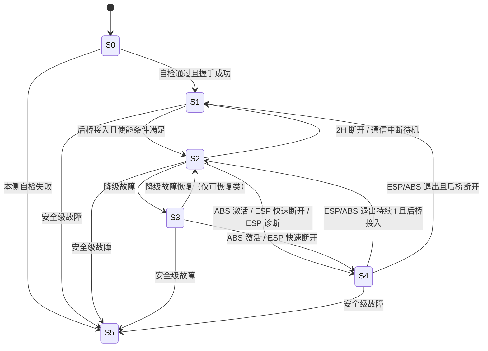
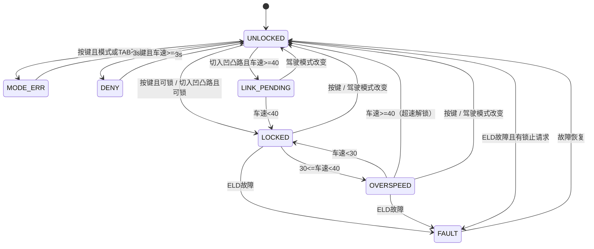
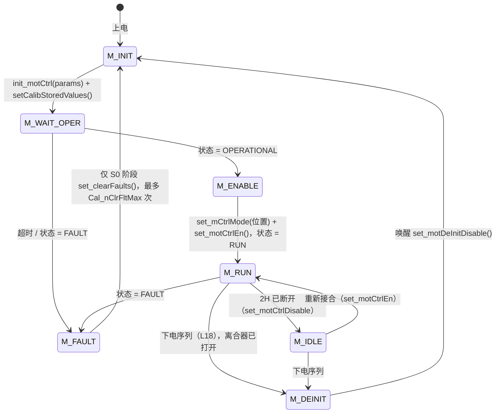
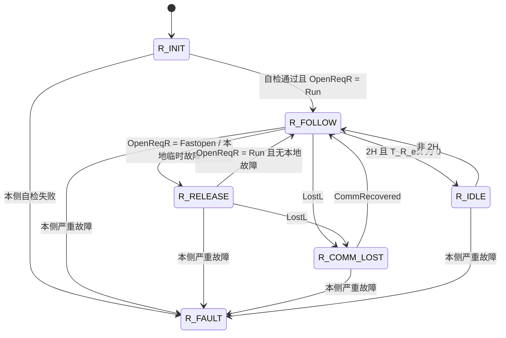
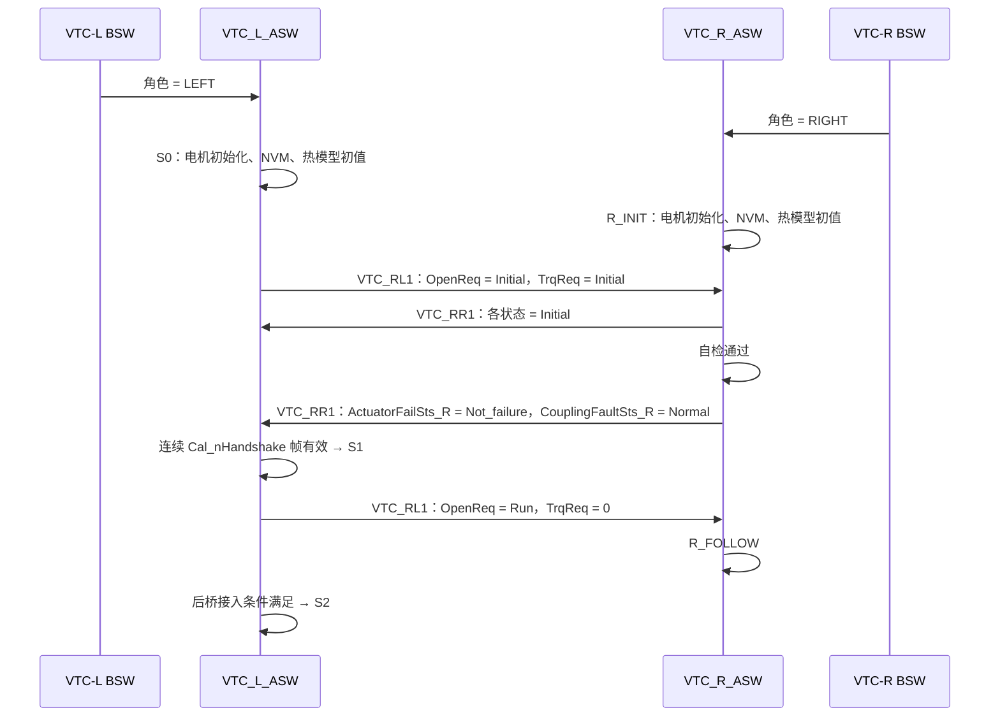
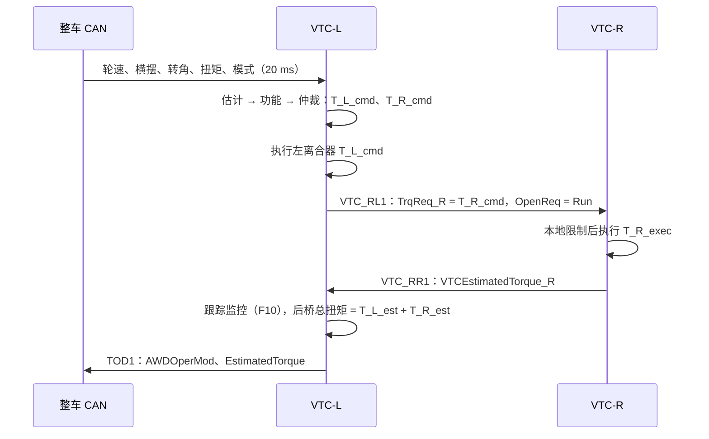
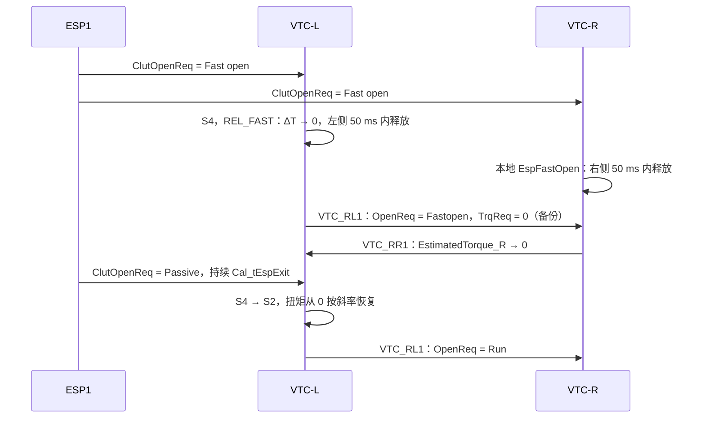
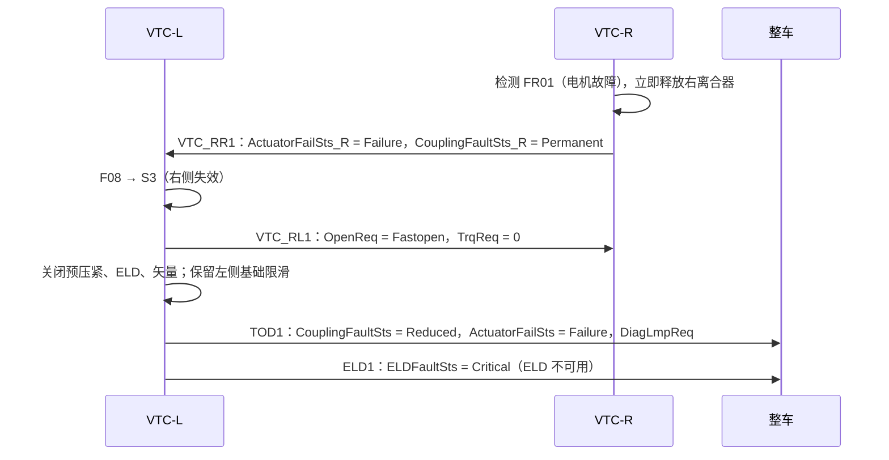
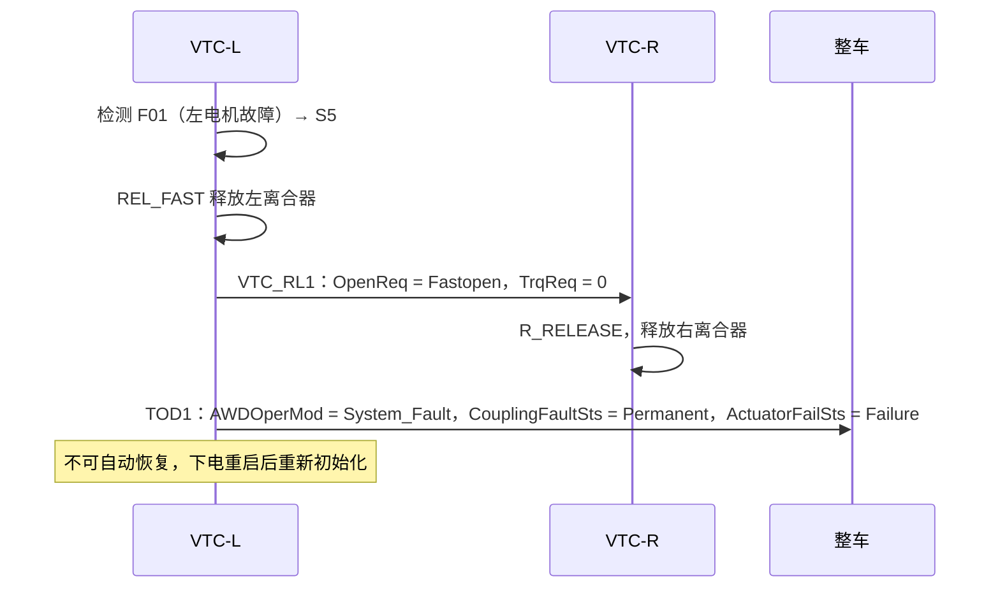
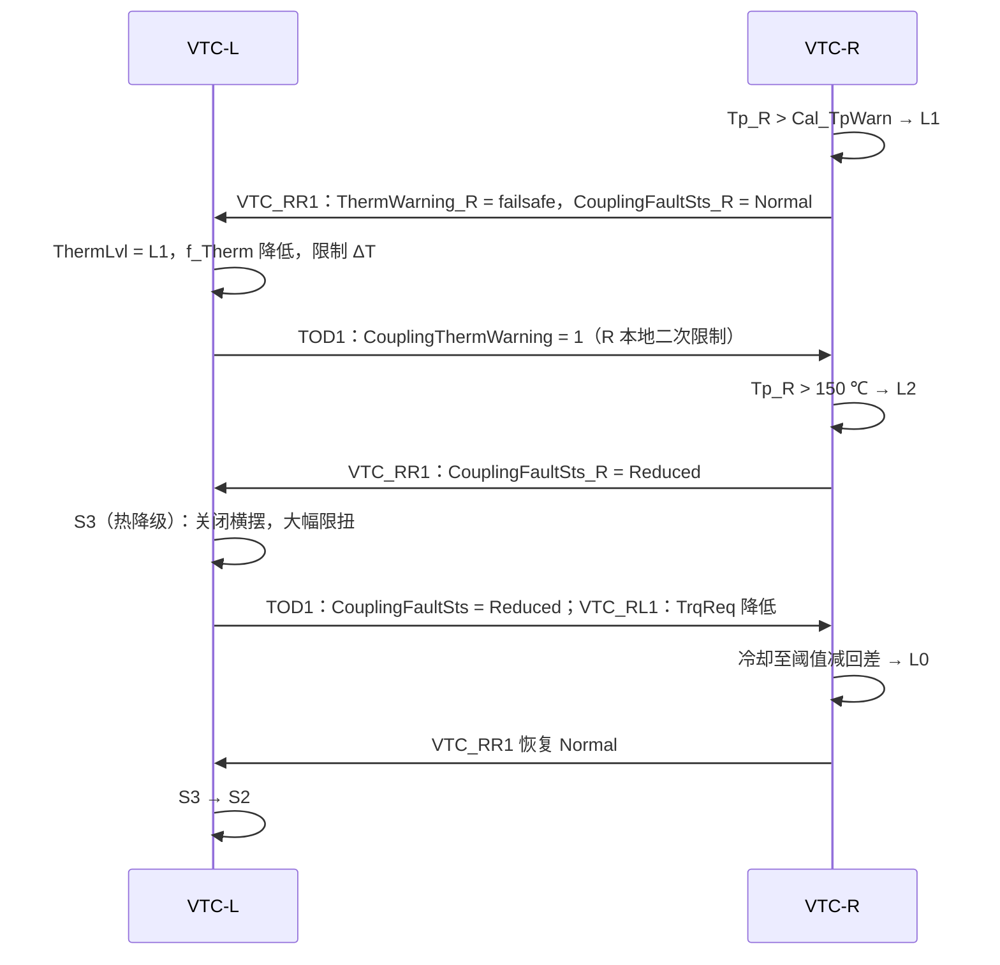

# B30 扭矩矢量控制系统（VTC）ASW 算法详细设计文档

## 0. 文档说明

### 0.1 目的

本文依据功能规范和数据接口清单，给出 VTC 系统两个应用层软件（ASW）的算法详细设计，用于指导 Simulink 建模、代码生成、标定和测试。

整个系统包含两个控制器，对应两个独立 ASW：

| ASW | 部署控制器 | 角色 |
|---|---|---|
| `VTC_L_ASW` | VTC-L（左离合器控制器） | 主控制器：工况识别、功能决策、全局状态机、左右目标扭矩计算、左离合器控制、整车报文发送 |
| `VTC_R_ASW` | VTC-R（右离合器控制器） | 从控制器：执行右轮目标扭矩、右离合器控制、本地安全监控、状态反馈 |

两个 ASW 分别与各自控制器的 BSW 编译链接，生成两个独立的烧录文件。

### 0.2 依据文件

| 编号 | 文件 | 用途 |
|---|---|---|
| [D1] | 《B30平台扭矩矢量控制系统功能规范》V1.0（`扭矩矢量控制系统功能规范-0928.docx`） | 功能需求、状态机、故障策略 |
| [D2] | `VTC_datalist_V1.0.xlsx`（Input、Output、电机接口） | ASW 与 BSW 的接口变量 |
| [D3] | B06-5-001-025MM01 C_Matrix for ICE BD_Sub_CAN_V2.0 | 位长、分辨率、周期、超时等以此为准（本文未获得该文件） |
| [D4] | `eLSD_Lib.h`、`eLSD_Lib_ComTypes.h`（项目已有头文件） | 枚举编码交叉核对 |

### 0.3 需求来源标注

为保证可追溯，文中关键条目使用以下标注：

- **【规范】**：直接来自 [D1] 或 [D2]；
- **【设计】**：规范未定义或定义不完整，由本文提出的设计决策，需评审批准；
- **【待确认】**：来源之间存在冲突或缺失，必须由需求、DBC 或供应商确认后才能冻结。

全部待确认问题汇总在第 8 章。

### 0.4 术语和缩写

| 缩写 | 含义 |
|---|---|
| VTC | Vectoring Torque Control，扭矩矢量减速器/控制系统 |
| VTC-L / VTC-R | 左/右离合器集成控制器 |
| ATC | Active Transfer Case 类四驱功能（规范中指 VTC-L 的四驱功能） |
| ELD | Electronic Locking Differential，电子差速锁功能（此处用限滑离合器模拟） |
| ASW / BSW | 应用层软件 / 底层软件 |
| ΔT | 左右扭矩差，定义为 `T_R − T_L` |
| US / OS | 转向不足（推头）/ 转向过度（甩尾） |
| DTC / DID | 诊断故障码 / 诊断数据标识 |
| NVM / FEE | 非易失存储 / Flash EEPROM 仿真 |

---

## 1. 系统架构与 ASW 划分

### 1.1 物理架构

【规范】车辆为前置前驱为主、后桥辅驱的适时四驱燃油车。后桥减速器左右两侧各集成一个限滑离合器（带控制器）：

- 左离合器由 VTC-L 控制；
- 右离合器由 VTC-R 控制；
- 两控制器通过 CAN 交互状态、扭矩、故障，周期 20 ms。

VTC 不产生驱动扭矩，只通过两侧离合器的传递扭矩容量分配后桥扭矩，产生左右扭矩差，形成附加横摆力矩。

### 1.2 两个 ASW 的职责划分

| 项目 | `VTC_L_ASW`（主） | `VTC_R_ASW`（从） |
|---|---|---|
| 包含功能 | ATC（四驱）、ELD、VTC-RL（矢量主控） | 右离合器执行、本地安全 |
| 全局状态机 | 拥有者（S0～S5） | 跟随者 |
| 发送报文 | ELD1（0x152）、TOD1（0x251）、VTC_RL1（0x160） | VTC_RR1（0x161） |
| 接收报文 | 整车报文 + VTC_RR1 | VTC_RL1 + TOD1 + 整车报文（用于本地安全监控） |
| 扭矩决策 | 计算左右目标扭矩 | 只执行右侧目标扭矩，可本地限制或释放，不可增加 |
| 故障仲裁 | 全局故障仲裁、DTC、状态上报 | 本侧故障检测、释放、上报 |
| 执行器 | 左电机/左离合器 | 右电机/右离合器 |

【设计】两个 ASW 共用一个通用算法库 `VTC_Common`（执行器扭矩-位置映射、热模型、扭矩估计、斜率限制等可复用函数），但分别建模、分别生成代码、分别与各自 BSW 链接。

【设计】每个 ASW 上电时调用 `eLSD_Lib_GetVtcRole()` 校验角色：VTC_L_ASW 要求 `LEFT`，VTC_R_ASW 要求 `RIGHT`。角色不符时判严重故障，禁止驱动离合器，防止错误刷写。

### 1.3 软件部署

```text
VTC-L ECU:  VTC_L_ASW + VTC-L BSW(eLSD_Lib, COM, 电机控制, 诊断, NVM, MCAL) -> VTC_L.hex
VTC-R ECU:  VTC_R_ASW + VTC-R BSW(eLSD_Lib, COM, 电机控制, 诊断, NVM, MCAL) -> VTC_R.hex
```

### 1.4 调度

- ASW 步进周期：5 ms，由 BSW 的 5 ms 客户回调调用【规范：eLSD_Lib 头文件】；
- CAN 报文周期：20 ms【规范】；
- 接收信号在报文到达时更新，ASW 每 5 ms 读取最新快照；
- 发送信号由 ASW 每 5 ms 更新，BSW 每 20 ms 发送当前快照。

### 1.5 功能优先级

【规范】ESP > 安全故障停机 > 牵引力脱困 > 常规弯道矢量 > 待机。

【设计】ELD 锁止是用户显式请求的工作模式（Auto1），在 S2 状态内覆盖牵引力和弯道矢量的扭矩分配，但仍低于 ESP 和安全停机。

### 1.6 总体数据流

```text
                    整车 CAN（ECM/ESP/ABS/ABM/CSA/BCM/DCT/EPB/PEPS/AC/HUT/IP）
                         |                                 |
                         v                                 v
┌──────────────────────── VTC_L_ASW ───────────┐   ┌──────── VTC_R_ASW ────────┐
│ L01 输入处理 -> L02 状态估计                  │   │ R01 输入处理              │
│ L03 模式管理  L04 主状态机                    │   │ R02 通信监控              │
│ L05 预压紧 L06 基础扭矩 L07 牵引 L08 横摆     │   │ R03 状态跟随              │
│ L09 ELD  L10 断开  L11 热管理  L12 故障       │   │ R04 指令处理与本地安全    │
│ L13 仲裁分配 -> L14 左执行器 / L15 扭矩估计   │   │ R05 热管理 R06 执行器     │
│ L16 报文输出  L17 对端监控  L18 诊断存储电源  │   │ R07 估计 R08 故障 R09 输出│
└──────────────┬───────────────────────▲───────┘   └──────┬──────────────▲─────┘
               │ VTC_RL1(右扭矩、断开请求)│ VTC_RR1           │              │
               │ TOD1(模式、故障、热)     │                  │              │
               └──────────────────────────┼──────────────────►              │
                                          └─────────────────────────────────┘
```

---

## 2. 通用设计约定

### 2.1 单位

ASW 内部统一使用国际单位：

| 物理量 | 内部单位 | 输入换算 |
|---|---|---|
| 车速、轮速 | m/s | km/h ÷ 3.6 |
| 方向盘转角、前轮转角 | rad | deg × π/180 |
| 横摆角速度 | rad/s | 按 DBC 解码 |
| 加速度 | m/s² | 按 DBC 解码 |
| 扭矩 | Nm | 按 DBC 解码 |
| 温度 | °C | 按 DBC 解码 |
| 时间 | s | — |

说明：ABS 轮速信号是轮缘线速度（km/h），即已经等于 `r_e·ω`，计算滑移率时不需要再乘轮胎半径。轮胎有效半径 `r_e` 只用于角速度、扭矩与力之间的换算。

### 2.2 符号约定

【规范】`SteerWheelAngSign = 0x0` 表示左转且为正，`0x1` 表示右转且为负。本文据此采用 ISO 8855 车辆坐标约定：

- 方向盘转角、前轮转角：左转为正；
- 横摆角速度：逆时针（向左）为正【待确认：ABM2 `VehYawRate` 的符号定义需与 DBC 核对】；
- 扭矩差：`ΔT = T_R − T_L`；
- `ΔT > 0` 时右轮驱动力大于左轮，产生正（向左）横摆力矩；
- 离合器扭矩 `T_L`、`T_R` 均为非负的传递扭矩容量（半轴端，Nm）。

左右扭矩差与横摆力矩的关系：

$$
M_z=\frac{B_r}{2}\left(F_R-F_L\right)=\frac{B_r}{2r_e}\left(T_R-T_L\right)
\quad\Rightarrow\quad
\Delta T=\frac{2r_e}{B_r}M_z
$$

其中 `B_r` 为后轮距。

### 2.3 计时和消抖

- 所有计时器以 `Ts = 5 ms` 累加；
- “持续 t 时间”指条件连续满足，中断即清零；
- 进入/退出阈值必须构成回差，进入时间和退出时间均不得为 0【规范】。

### 2.4 斜率限制和释放曲线

通用斜率限制函数：

```text
y(k) = y(k-1) + clamp(x_target - y(k-1), -R_down*Ts, +R_up*Ts)
```

定义三种释放曲线：

| 曲线 | 使用场景 | 要求 |
|---|---|---|
| `REL_FAST` | ESP 快速断开、安全停机、通信中断、单侧故障 | 【规范】先将 ΔT 置 0，再左右同步释放，50 ms 内完成 |
| `REL_SOFT` | ABS/ESP 激活（S4 临时暂停） | 【规范】ΔT 置 0，离合器逐步/缓慢释放 |
| `REL_NORMAL` | 2H 断开、功能正常退出、降级 | 【规范】停止新增扭矩，按受控斜率降至 0 |

### 2.5 信号质量和替代值

每个输入信号输出“物理值 + 有效位”。信号无效时使用替代值，并通知依赖该信号的功能退出或降级（第 4.1 节）。

### 2.6 标定量命名

| 前缀 | 类型 | 示例 |
|---|---|---|
| `Cal_` | 标量 | `Cal_VxVtcMax` |
| `Crv_` | 一维曲线 | `Crv_SlipOn(Vx)` |
| `Map_` | 二维表 | `Map_SlipOuterFac(Vx, SWA)` |

---

## 3. VTC_L_ASW 软件架构

### 3.1 模块划分

| 编号 | 模块 | 功能类别 | 周期 |
|---|---|---|---|
| L01 | `InputProcessing` | 输入信号处理与有效性判断 | 5 ms |
| L02 | `VehicleStateEstimation` | 参考车速、轮心速度、滑移率、前轮转角、驱动扭矩估计 | 5 ms |
| L03 | `ModeManager` | 驾驶模式映射、四驱模式（AWDOperMod） | 5 ms |
| L04 | `SystemStateMachine` | 主状态机 S0～S5 与功能使能仲裁 | 5 ms |
| L05 | `LaunchPreload` | 起步预压紧（四驱功能） | 5 ms |
| L06 | `AwdBaseTorque` | 后桥基础扭矩（自动四驱） | 5 ms |
| L07 | `TractionControl` | 牵引力提升辅助（矢量限滑） | 5 ms |
| L08 | `YawControl` | 弯道加速与横摆抑制 | 5 ms |
| L09 | `EldControl` | ELD 锁止/拒锁/超速报警/解锁 | 5 ms |
| L10 | `Disconnect` | 2H 断开与重新接合 | 5 ms |
| L11 | `ThermalManager` | 左离合器热模型与全局热保护 | 5 ms |
| L12 | `FaultManager` | 故障检测、分级、降级、DTC、指示灯 | 5 ms |
| L13 | `TorqueArbitration` | 扭矩仲裁与左右分配 | 5 ms |
| L14 | `ActuatorControl_L` | 左离合器执行器控制 | 5 ms |
| L15 | `TorqueEstimation` | 左右/后桥估算扭矩 | 5 ms |
| L16 | `ComTx` | ELD1、TOD1、VTC_RL1 信号生成 | 5 ms（20 ms 发送） |
| L17 | `PeerMonitor` | VTC_RR1 通信与状态监控 | 5 ms |
| L18 | `DiagStoragePower` | DID、快照、EEPROM、电源管理 | 5 ms |

### 3.2 同一周期内的执行顺序

```text
L01 -> L17 -> L02 -> L03 -> L11 -> L12 -> L04
    -> L09 -> L10 -> L05 -> L06 -> L07 -> L08
    -> L13 -> L14 -> L15 -> L16 -> L18
```

原则：先确定输入、对端状态和故障，再决定系统状态；功能模块只在状态机允许时输出扭矩请求；仲裁模块最后汇总。故障和热管理结果在同一周期生效，不引入额外一拍延迟。

---

## 4. VTC_L_ASW 功能详细设计

### 4.1 L01 输入信号处理

#### 4.1.1 功能概述

把 BSW 提供的原始信号和报文校验标志转换为带有效位的物理量，执行范围检查、替代值处理和滤波。

#### 4.1.2 输入

【规范：[D2] Input 表】BSW 以全局变量形式为每条报文提供四类校验标志，以及信号原值：

| 报文 | 校验标志 | 使用的信号 |
|---|---|---|
| ABS1 | Checksum、DLC、Flag、RollCheck | `FLWheelSpd`、`FRWheelSpd`、`FLWheelSpdVld`、`FRWheelSpdVld`、`FLWheelDriveDirection`、`FRWheelDriveDirection` |
| ABS2 | 同上 | `RLWheelSpd`、`RRWheelSpd`、`RLWheelSpdVld`、`RRWheelSpdVld`、`RLWheelDriveDirection`、`RRWheelDriveDirection` |
| ABS3 | 同上 | `VehSpd`、`VehSpdVld`、`ABSActv` |
| ECM1 | 同上 | `EngSpd`、`EngSpdVldty`、`BrkPedalSts` |
| ECM2 | 同上 | `AccelPedalPosn`、`AccelPedalPosnVldty`、`EngState` |
| ECM3 | 同上 | `MaxEngTrqNorm` |
| ECM4 | 同上 | `NetEngTrq`、`DrvEngTrqReq`、`DrvEngTrqReqVld` |
| ECM7 | 同上 | `EngTrqEstimdActGear`、`EngTrqEstimdActGear_Qf` |
| ESP1 | 同上 | `ClutOpenReq` |
| ESP2 | 同上 | `DrivingModReq_ESP`、`DrivingModDis`、`ESP_DiagActv`、`TAB_Sts` |
| ABM2 | 同上 | `VehYawRate`、`VehLatAccel`、`VehLgtAccel` 及三个有效位 |
| CSA2 | 同上 | `SteerWheelAng`、`SteerWheelAngSign`、`SAS_Sts` |
| DCT5 | 同上 | `TGS_LEVER`、`CURRENT_GEAR`、`CurrentGearValid` |
| EPB1 | 同上 | `EPBSts` |
| PEPS2 | 同上 | `BrkOrClutSwt` |
| BCM1 | 同上 | `ReversGearSts` |
| BCM3 | 同上 | `VehicleSoakTime` |
| BCM6 | 同上 | `RearELDLckSwtReq`、`RearELDLckSwtErrSts` |
| AC2 | 同上 | `ACAmbTemp` |
| HUT34 | DLC、Flag | 时间、日期 |
| IP2 | DLC、Flag | `IP_VehTotDistance`、`IP_VehTotDistanceValid` |
| VTC_RR1 | 【待确认】数据清单未列出 | 见 L17 |

#### 4.1.3 输出

| 输出 | 单位 | 含义 |
|---|---|---|
| `MsgOk_x` | 0/1 | 报文 x 本周期可用 |
| `VehSpd_mps`、`VehSpd_Vld` | m/s | ABS 车速 |
| `VehSpd_kph` | km/h | ABS 车速原值，用于 ELD 等以车速 km/h 定义的阈值 |
| `vW_FL/FR/RL/RR`、`vW_x_Vld` | m/s | 四轮轮缘速度 |
| `WhlDir_x` | 枚举 | 车轮转动方向 |
| `YawRate`、`Yaw_Vld` | rad/s | 实测横摆角速度 |
| `ay`、`ax` 及有效位 | m/s² | 横向、纵向加速度 |
| `SWA`、`SWA_Vld` | rad | 带符号方向盘转角，左正 |
| `Pedal`、`PedalRate`、`Pedal_Vld` | %、%/s | 油门开度与变化率 |
| `EngTrq_Nm`、`EngTrq_Vld` | Nm | 发动机扭矩 |
| `Gear`、`Lever`、`Gear_Vld` | 枚举 | 档位、换挡杆 |
| `BrkActv` | 0/1 | 制动/离合开关激活 |
| `EpbReleased` | 0/1 | 电子驻车已释放 |
| `AbsActv` | 0/1 | ABS 激活 |
| `EspClutReq` | 枚举 | 0 被动，1 快速断开，2 扭矩上限，3 错误 |
| `EspDiagActv` | 0/1 | ESP 诊断激活 |
| `ModeReq`、`ModeDis`、`TabSts` | 枚举 | 驾驶模式请求、显示、TAB 状态 |
| `EldSwPress`、`EldSwErr` | 0/1 | ELD 按键按下事件、按键故障 |
| `AmbTemp`、`SoakTime` | °C、min | 环境温度、停车浸置时间 |
| `Odometer`、`DateTime` | km、— | 里程、时间（诊断用） |

#### 4.1.4 详细流程与逻辑

**步骤 1：报文级有效性**

```text
MsgErr_x  = (x_Checksum != 0) || (x_DLC != 0) || (x_RollCheck != 0)
MsgLost_x = (x_Flag != 0)
MsgOk_x   = !MsgErr_x && !MsgLost_x
```

- 标志值 0x02～0xFF 为无效编码，按错误处理；
- HUT34、IP2 没有 Checksum 和 RollCheck，只检查 DLC 和 Flag；
- 报文故障（用于 DTC）采用计数消抖：错误时计数加 `Cal_MsgErrInc`，正常时减 `Cal_MsgErrDec`，达到 `Cal_MsgErrThr` 确认故障，降为 0 解除。控制功能使用的 `MsgOk_x` 不做消抖，立即生效。

**步骤 2：信号级有效性**

| 信号 | 有效条件 | 物理换算 |
|---|---|---|
| 车速 | `MsgOk_ABS3 && VehSpdVld==1 && VehSpd ≤ 299.98 km/h`（原值 ≤ 0x14D5） | `VehSpd/3.6` |
| 轮速 | `MsgOk && WheelSpdVld==1 && 原值 ≤ 0x14D5` | `WheelSpd/3.6` |
| 横摆角速度 | `MsgOk_ABM2 && VehDynYawRateVld==1 && 原值 ≤ 0x4421` | 按 DBC【待确认】 |
| 横/纵向加速度 | `MsgOk_ABM2 && Vld==1 && 原值 ≤ 0xAC22` | 按 DBC【待确认】 |
| 方向盘转角 | `MsgOk_CSA2 && SAS_Sts==0 && 原值 ≤ 0x1E78` | 幅值转 rad；`Sign==0` 取正，`Sign==1` 取负 |
| 油门 | `MsgOk_ECM2 && AccelPedalPosnVldty==1` | 按 DBC 换算为 %【待确认】 |
| 发动机扭矩 | 优先 `EngTrqEstimdActGear_Qf==1`；否则 `NetEngTrq≠0xFFFF` | `%/100 × 最大扭矩`（`MaxEngTrqNorm` 换算方式【待确认】） |
| 档位 | `MsgOk_DCT5 && CurrentGearValid==1` | `CURRENT_GEAR`、`TGS_LEVER` |
| 制动 | 见下 | — |
| 环境温度 | `MsgOk_AC2 && ACAmbTemp ≤ 0xFD` | 按 DBC |
| 浸置时间 | `MsgOk_BCM3 && VehicleSoakTime ≤ 0x3E8` | min |

制动激活：

```text
BrkActv = (MsgOk_PEPS2 && BrkOrClutSwt==1)
       || (MsgOk_ECM1  && BrkPedalSts==1)
       || (!MsgOk_PEPS2 && !MsgOk_ECM1)      // 两路都不可用时保守认为制动
```

ELD 按键事件：

```text
EldSwErr   = MsgOk_BCM6 && RearELDLckSwtErrSts==1
EldSwPress = MsgOk_BCM6 && !EldSwErr && 上升沿(RearELDLckSwtReq: 0 -> 1)
             && 距上次事件 > Cal_tEldSwDebounce
```

按键识别为上升沿事件，长按不会重复触发。

**步骤 3：替代值策略**

| 信号失效 | 替代值 | 影响的功能 |
|---|---|---|
| 车速 | 由轮速/加速度融合（L02） | 融合也失效时：牵引、横摆、预压紧、ELD 锁止不可用 |
| 后轮速 | 0，有效位 0 | 牵引力辅助关闭 |
| 前轮速 | 0，有效位 0 | 前轴打滑反馈关闭 |
| 横摆角速度 | 0，有效位 0 | 横摆控制关闭 |
| 方向盘转角 | 0，有效位 0 | 横摆控制关闭，转弯阈值修正取 1 |
| 油门 | 0 | 预压紧和基础扭矩前馈关闭 |
| 发动机扭矩 | 0 | 基础扭矩前馈关闭 |
| ABS 激活（ABS3 失效） | 1 | 【设计】按 ABS 激活处理，暂停主动功能 |
| ESP1 失效 | `EspClutReq=0` 且置 `EspIfFault` | 【设计】无法保证 ESP 优先级，禁止主动矢量 |
| ESP2 失效 | 保持上次模式 `Cal_tModeHold` | 见 L03 |
| 环境温度 | `Cal_AmbTempDefault`（25 °C） | 热模型初值 |
| 浸置时间 | 0 | 热模型保守初始化（视为未冷却） |

**步骤 4：滤波**

- 轮速：一阶低通 `τ = Cal_TauWhl`；
- 横摆角速度、横向加速度：一阶低通 `τ = Cal_TauYaw`；
- 油门变化率：差分后一阶低通 `τ = Cal_TauPedalRate`。

#### 4.1.5 设计原理

- 报文级（通信完整性）和信号级（发送方声明的有效性）分开判断，避免误用陈旧或损坏的数据；
- 控制使用立即生效的有效位，诊断使用消抖后的故障，兼顾控制安全和 DTC 稳定；
- 替代值遵循“故障安全”原则：无法判断时选择让主动功能退出的值，例如 ABS 状态不可知时按激活处理，制动状态不可知时按制动处理。

---

### 4.2 L02 车辆状态估计

#### 4.2.1 功能概述

计算控制所需的车辆状态：整车参考车速、各车轮中心参考速度、左右后轮驱动滑移率、前轮转角、转向方向、前后轴转速差、驱动扭矩估计和运动方向。

#### 4.2.2 输入

L01 的车速、四轮速、横摆角速度、纵/横向加速度、方向盘转角、发动机扭矩、档位、车轮方向；L07 的打滑车轮隔离标志。

#### 4.2.3 输出

| 输出 | 单位 | 含义 |
|---|---|---|
| `Vx` | m/s | 整车参考车速 |
| `Vx_Vld` | 0/1 | 参考车速有效 |
| `vRef_FL/FR/RL/RR` | m/s | 各车轮中心纵向参考速度 |
| `s_RL`、`s_RR` | — | 左右后轮驱动滑移率 |
| `SlipLow_RL/RR` | 0/1 | 低速区打滑标志 |
| `delta_f` | rad | 前轮转角 |
| `TurnDir` | 枚举 | LEFT / RIGHT / STRAIGHT |
| `TurnPlausible` | 0/1 | 转向方向一致性检查通过 |
| `dV_FR` | m/s | 前后轴速度差（前轴打滑量） |
| `T_drvAxle` | Nm | 驱动系统总轮端扭矩估计 |
| `MoveDir` | 枚举 | FORWARD / REVERSE / STOP |

#### 4.2.4 详细流程与逻辑

**步骤 1：整车参考车速**

【规范】不得直接比较左右后轮速识别打滑轮。应选择可信轮速并与纵向加速度融合估算参考车速，或使用 ABS 车速；被判定打滑的车轮从参考车速更新中隔离。

```text
若 VehSpd_Vld:
    Vx = VehSpd_mps                                 // 优先使用 ABS 车速
否则:
    Vx_pred = Vx(k-1) + Ts * ax                     // ax 无效时取 0
    对每个有效且未被隔离的车轮 i:
        v_i,c = vW_i - 横摆补偿(i)                  // 换算到车辆中心
    驱动工况: Vx_meas = min(v_i,c)                  // 驱动打滑时最慢轮最接近真实车速
    制动工况: Vx_meas = max(v_i,c)
    Vx = Vx_pred + Cal_KVxFuse * (Vx_meas - Vx_pred)
    Vx 变化率限制在 [Cal_AxMin, Cal_AxMax] 内
    Vx_Vld = (有效且未隔离的车轮数 ≥ 2)
```

**步骤 2：车轮中心参考速度**

```text
vRef_RL = max(Vx - YawRate * B_r/2, 0)
vRef_RR = max(Vx + YawRate * B_r/2, 0)
vRef_FL = max(Vx - YawRate * B_f/2, 0) / cos(delta_f)
vRef_FR = max(Vx + YawRate * B_f/2, 0) / cos(delta_f)
```

左转（YawRate > 0）时左侧为内侧，参考速度较低；前轮按转向角投影修正。横摆角速度无效时取 0，此时只能在直线工况使用滑移率。

**步骤 3：驱动滑移率**

【规范】

$$
s_i=\frac{r_e\omega_i-v_{x,i}}{\max\left(r_e\omega_i,\;v_{x,i},\;v_\varepsilon\right)}
$$

由于 ABS 轮速已经是轮缘线速度：

```text
s_RL = (vW_RL - vRef_RL) / max(vW_RL, vRef_RL, Cal_vEps)
s_RR = (vW_RR - vRef_RR) / max(vW_RR, vRef_RR, Cal_vEps)
```

**步骤 4：低速区打滑判断**

【规范】低速区应改用轮速差和轮加速度判断。当 `Vx < Cal_VxLowSlip` 时：

```text
SlipLow_i = (vW_i - vRef_i > Cal_dVLowSlip)
         || (d(vW_i)/dt - ax > Cal_aWhlSlip)
```

**步骤 5：前轮转角和转向方向**

【规范】前轮转角必须通过经批准的转向映射获得，不得只用固定传动比：

```text
delta_f = SWA / Map_SteerRatio(|SWA|, Vx)
```

转向方向：

```text
TurnDir = LEFT     若 SWA >  Cal_SwaTurnOn  且 SWA_Vld 且 TurnPlausible
        = RIGHT    若 SWA < -Cal_SwaTurnOn  且 SWA_Vld 且 TurnPlausible
        = STRAIGHT 若 |SWA| < Cal_SwaTurnOff
        = 保持上一状态（回差区）
```

**步骤 6：转向一致性检查**

【规范】要求方向盘转角有效并满足一致性检查才能判定转向方向。【设计】检查内容：

- `SAS_Sts == 0`（转角传感器已标定且无错误）；
- 转角变化率不超过物理上限 `Cal_SwaRateMax`；
- 在低动态工况（`|e_yaw| < Cal_eYawQuasiSS` 且 `Vx > Cal_VxPlausMin`）下，`sign(SWA)` 与 `sign(YawRate)`、`sign(ay)` 一致，且 `|ay − Vx·YawRate| < Cal_ayYawTol`；
- 高动态工况（例如过度转向时驾驶员反打方向）下不做符号一致性判断，因为反打方向盘是合法操作。

连续不一致超过 `Cal_tPlausFail` 时 `TurnPlausible = 0`，并上报“其他故障”。

**步骤 7：前后轴速度差**

```text
dV_FR = mean(vW_FL - vRef_FL, vW_FR - vRef_FR)
      - mean(vW_RL - vRef_RL, vW_RR - vRef_RR)
```

经过横摆和转向几何补偿后，`dV_FR > 0` 表示前轴相对后轴打滑。

**步骤 8：驱动扭矩估计**

```text
T_eng    = EngTrq_Nm
i_gear   = Crv_GearRatio(CURRENT_GEAR)     // N/P 或无效时为 0；R 档取负值
T_drvAxle = T_eng * i_gear * Cal_iFinal * Cal_EtaDrv
```

**步骤 9：运动方向**

```text
MoveDir = REVERSE  若后轮方向为 Backward，或 ReversGearSts==On，或 Lever==R
        = STOP     若 Vx < Cal_VxStop 且车轮方向为 Stop
        = FORWARD  其他
```

#### 4.2.5 设计原理

- **车轮中心参考速度**：转弯时内外侧车轮的地面速度天然不同，必须先用 `YawRate·B/2` 补偿，否则外侧轮会被误判为打滑、内侧轮会被漏判；
- **打滑轮隔离**：打滑轮速高于实际车速，参与参考车速计算会抬高 `Vx`，导致滑移率被低估；
- **`v_ε`**：防止低速时分母接近 0 造成滑移率数值放大；低速区滑移率意义有限，因此改用轮速差和轮加速度；
- **转向映射**：转向系统的传动比随转角和车速变化，固定传动比在大转角或高速时误差大。

---

### 4.3 L03 驾驶模式与四驱模式管理

#### 4.3.1 功能概述

【规范】根据 ESP2 地形模式请求划分 Auto1～Auto4 和 2H 五种四驱模式，并为每种模式选择不同的触发阈值和扭矩参数（“同硬件、多性格”），通过 TOD1 `AWDOperMod` 上报。

#### 4.3.2 输入

`ModeReq`（DrivingModReq_ESP）、`ModeDis`（DrivingModDis）、`MsgOk_ESP2`、ELD 状态（L09）、系统状态（L04）、故障等级（L12）。

#### 4.3.3 输出

| 输出 | 含义 |
|---|---|
| `AwdModeBase` | 由驾驶模式映射得到的模式：Auto2/Auto3/Auto4/2H |
| `AWDOperMod` | 最终上报模式（含 Auto1 和 System_Fault） |
| `ModePar` | 当前模式参数集 |
| `RearConnectReq` | 后桥接入请求（0 = 2H 断开） |
| `ModeChangeEvt` | `ModeReq` 编码改变事件（用于 ELD 联动解锁） |
| `ModeIsEldManual` | 当前模式允许手动锁止（雪地、泥地、沙地） |
| `ModeIsEldLink` | 当前模式为凹凸路（联动锁止） |

#### 4.3.4 详细流程与逻辑

**步骤 1：模式映射表**【规范】

| 地形模式 | `ModeReq` | 四驱模式 | `AWDOperMod` | 横摆参数 | 滑移参数 | 目标预压紧/最大锁止率 |
|---|---|---|---|---:|---:|---|
| 标准 | 0x01 | Auto2 | 0x3 | 0.25 | 0.15 | 15%～35% |
| 雪地 | 0x03 | Auto2 | 0x3 | 0.25 | 0.15 | 15%～35% |
| 运动 | 0x02 | Auto3 | 0x4 | 0.8 | 0.25 | 35%～50% |
| 狂暴 | 0x19 | Auto3 | 0x4 | 0.8 | 0.25 | 35%～50% |
| 赛道 | 0x1A | Auto3 | 0x4 | 0.8 | 0.25 | 35%～50% |
| 草地/砾石 | 0x1B | Auto3 | 0x4 | 0.8 | 0.25 | 35%～50% |
| 泥地 | 0x05 | Auto4 | 0x5 | 0.5 | 0.3 | 50%～75% |
| 沙地 | 0x07 | Auto4 | 0x5 | 0.5 | 0.3 | 50%～75% |
| 越野 | 0x0D | Auto4 | 0x5 | 0.5 | 0.3 | 50%～75% |
| 凹凸 | 0x1C | Auto4 | 0x5 | 0.5 | 0.3 | 50%～75% |
| 经济 | 0x0A | 2H | 0x6 | 0 | 0 | 0 |

【设计】参数含义解释（规范只给出数值，需评审确认）：

- **横摆参数** `K_YawMode`：横摆控制输出增益权重。运动模式最高（0.8），“更看重横摆增益”；
- **滑移参数** `S_Mode`：滑移进入阈值的模式基准。以标准模式 0.15 为 1，滑移阈值模式系数为 `f_SlipMode = S_Mode / 0.15`；泥沙模式允许更大滑移，有利于松软路面的通过性；
- **目标预压紧/最大锁止率** `[P_min, P_max]`：以单侧离合器最大扭矩容量为 100%，预压紧取值范围为 `P_min～P_max`，同时 `P_max` 作为该模式下自动功能（非 ELD）的单侧扭矩容量上限。

**步骤 2：未列出模式的处理**【待确认】

0x00、0x04、0x08、0x09、0x0B、0x0C、0x0E、0x10～0x18、0x1D～0x1F 未定义映射。【设计】暂按 Auto2 处理并记录“其他故障”。0x0F 及超出范围的编码视为无效。

**步骤 3：模式有效性和保持**

```text
若 MsgOk_ESP2 且 ModeReq 为有效编码:
    ModeReqStable = 连续 Cal_nModeStable 个周期相同的 ModeReq
否则:
    保持上次 ModeReqStable，计时 Cal_tModeHold
    超时后: AwdModeBase = Auto2，且置 EspIfFault（禁止主动矢量）
```

**步骤 4：后桥接入判断**

【规范】VTC 仅在后桥辅驱接入（非 2H）时激活。规范中“`DrivingModDis≠0x6:Economic`”与“`DrivingModDis=0xA:Economic`”存在编码冲突【待确认】。【设计】使用三个来源一致的 `DrivingModReq_ESP` 判断：

```text
RearConnectReq = (ModeReqStable != 0x0A)
```

`DrivingModDis` 在编码确认后作为交叉校验：两者长期不一致时记录“其他故障”，并按更保守的结果（断开）执行。

**步骤 5：模式切换事件**

```text
ModeChangeEvt = (ModeReqStable(k) != ModeReqStable(k-1))
```

**步骤 6：参数平滑过渡**【设计】

模式切换时，阈值和增益在 `Cal_tModeBlend` 内线性过渡，避免扭矩突变。

**步骤 7：最终上报模式**

```text
若 故障等级为严重 或 SysState == S5:  AWDOperMod = 0x1 System_Fault
否则若 RearConnectReq == 0:            AWDOperMod = 0x6 2H
否则若 ELD 状态为 Locked 或 OverSpeedWarning: AWDOperMod = 0x2 Auto1
否则:                                   AWDOperMod = AwdModeBase
```

【规范】凹凸模式在车速 ≥ 40 km/h 时请求联动锁止被拒，在锁止前保持 Auto4（0x5）。该规则由上式自然满足。

#### 4.3.5 设计原理

- 模式只决定参数，不决定控制结构。牵引、横摆、预压紧算法在所有模式中相同，只更换阈值和增益，便于验证；
- 模式请求需要稳定若干周期，防止 CAN 偶发错误导致四驱模式和 ELD 状态误切换；
- 使用请求信号而非显示信号判断断开，是因为显示信号编码在不同文档中不一致，而断开会直接改变驱动形式，必须避免误判。

---

### 4.4 L04 系统主状态机与功能仲裁

#### 4.4.1 功能概述

【规范】VTC-L 是全局状态机的拥有者，VTC-R 跟随执行。系统有 S0～S5 六个状态。

#### 4.4.2 输入

自检结果、`RearConnectReq`、`AbsActv`、`EspClutReq`、`EspDiagActv`、`EspIfFault`、故障等级与故障类型（L12）、对端状态（L17）、热等级（L11）、车速。

#### 4.4.3 输出

| 输出 | 含义 |
|---|---|
| `SysState` | S0～S5 |
| `En_Preload`、`En_AwdBase`、`En_Trac`、`En_Yaw`、`En_Eld` | 各功能使能 |
| `RelProfile` | `REL_FAST` / `REL_SOFT` / `REL_NORMAL` / 无 |
| `DegradeType` | 无 / 右侧失效 / 热降级 / 传感器降级 |
| `CommStandby` | 对端通信中断待机标志 |

#### 4.4.4 状态定义

| 状态 | 名称 | 离合器行为 |
|---|---|---|
| S0 | 上电初始化 | 释放；自检；与 VTC-R 握手 |
| S1 | 待机就绪 | 完全释放（开式差速）；监测整车信号 |
| S2 | 正常控制 | 执行预压紧、基础扭矩、牵引、横摆、ELD |
| S3 | 降级控制 | 矢量功能关闭，仅保留基础限滑 |
| S4 | 临时暂停 | ΔT 置 0，离合器释放；ESP 退出后恢复 |
| S5 | 安全停机 | ΔT 置 0，同步释放；禁止主动分配；需下电重启 |

#### 4.4.5 状态转换



转换条件细节：

| 转换 | 条件 |
|---|---|
| S0→S1 | 【规范】自检正常。【设计】自检内容：角色校验正确；电机应用状态达到 OPERATIONAL；位置传感器对齐完成；NVM 读取成功；连续收到 `Cal_nHandshake` 帧有效 VTC_RR1 且其状态非 Initial；用时不超过 `Cal_tInitMax` |
| S0→S5 | 本侧自检失败（角色错误、电机故障、位置传感器故障） |
| S0 超时且仅握手失败 | 【设计】进入 S1，并置 `CommStandby`，不进入 S2 |
| S1→S2 | `RearConnectReq && !严重故障 && !CommStandby && !AbsActv && EspClutReq≠1 && !EspIfFault` |
| S2→S1 | `RearConnectReq==0`（2H，`REL_NORMAL`）；或对端心跳丢失（`CommStandby=1`，`REL_FAST`） |
| S2→S3 | 右侧离合器故障；右侧热失效；本侧热保护等级 L2；横摆/转角传感器失效（仅关闭矢量） |
| S2/S3→S4 | `AbsActv==1`（`REL_SOFT`）；`EspClutReq==1` 快速断开（`REL_FAST`）；`EspDiagActv==1`（【设计】`REL_SOFT`） |
| S4→S2/S1 | 上述 ESP 条件全部消失且持续 `Cal_tEspExit`；按 `RearConnectReq` 选择 S2 或 S1 |
| 任意→S5 | 左侧离合器/执行器严重故障；不可恢复，只在下电后重新初始化 |
| `CommStandby` 恢复 | 【设计】连续 `Cal_nCommRecover` 帧有效 VTC_RR1，返回 S1 后再按条件进入 S2 |

每周期的判断优先级：S5 > S4 > `CommStandby` > S3 > S2/S1。

#### 4.4.6 功能使能

| 状态 | 预压紧 | 基础扭矩 | 牵引 | 横摆 | ELD |
|---|---|---|---|---|---|
| S0、S1、S4、S5 | 关 | 关 | 关 | 关 | 关（ELD 逻辑状态见 L09） |
| S2 | 开 | 开 | 开 | 开 | 开 |
| S3（右侧失效） | 【规范】关 | 仅左侧 | 仅左侧基础限滑 | 关 | 【规范】关 |
| S3（热降级/传感器降级） | 开 | 开（限幅） | 开（弱） | 关 | 开（限幅） |

#### 4.4.7 设计原理

- 单一状态机拥有者避免两个控制器各自决策造成不一致；
- 安全停机不可自动恢复，防止间歇故障反复接合离合器；
- 临时暂停与降级分离：ESP 激活是正常的外部优先级，不是故障，不应记录 DTC，退出后应自动恢复；
- 2H 断开使用受控斜率，ESP 快速断开和安全类事件使用快速释放，满足 50 ms 要求。

---

### 4.5 L05 起步预压紧（四驱功能）

#### 4.5.1 功能概述

【规范】消除离合器摩擦片间隙，消除起步四驱响应延迟；防止起步瞬间前轮打滑，提升起步牵引力。Auto2～Auto4 生效，2H 和 Auto1 不生效。

#### 4.5.2 输入

`Vx`、`Lever`、`Gear`、`EpbReleased`、`BrkActv`、`Pedal`、`PedalRate`、`AbsActv`、`EspClutReq`、`AWDOperMod`、`ModePar.P_min/P_max`、`dV_FR`、`En_Preload`、故障等级。

#### 4.5.3 输出

| 输出 | 单位 | 含义 |
|---|---|---|
| `T_Pre` | Nm | 单侧预压紧扭矩（左右相同） |
| `PreState` | 枚举 | IDLE / LAUNCH / ADAPT / EXIT |

#### 4.5.4 详细流程与逻辑

**进入条件（全部满足）**

| 条件 | 判据 | 来源 |
|---|---|---|
| 车速 | `Vx < 5 km/h`（`Cal_VxPreOn`） | 【规范】 |
| 档位 | `Lever ∈ {D, R, M}` 且 `CURRENT_GEAR ≠ N/P` | 【规范】D/R 档 |
| 制动释放 | `EpbReleased == 1` 且 `BrkActv == 0` | 【待确认】规范写为 `EPBSts=0x1:Closed`，与“制动释放”矛盾，本文按 `Released` 设计 |
| 起步意图 | `Pedal > Cal_PedalPreOn` 且 `PedalRate > Cal_PedalRatePreOn` | 【规范】 |
| 无系统故障 | 故障等级低于降级 | 【规范】 |
| 无 ESP 干预 | `AbsActv==0` 且 `EspClutReq ≠ 1` | 【规范】 |
| 模式 | `AWDOperMod ∉ {2H, Auto1}` | 【规范】 |
| 状态机 | `En_Preload == 1` | 【设计】 |

**附加触发**：【规范】`ClutOpenReq == 0x2`（Torque max limit）时开启预压紧，不要求油门条件。【待确认】该编码名称为“扭矩上限”，规范将其解释为“ESP 请求四驱结合”，需要与 ESP 供应商确认语义。

**控制流程**

```text
IDLE:
    满足进入条件 -> LAUNCH

LAUNCH:                                 // 起步阶段，压紧到较大预压紧
    T_Pre_tgt = Map_Preload(AwdMode, Pedal)  ∈ [P_min, P_max] * Cal_TrqCapMax
    T_Pre 以 Cal_RPreUp 斜率上升至 T_Pre_tgt
    Vx > 10 km/h (Cal_VxPreAdapt) -> ADAPT

ADAPT:                                  // 起步后自适应
    若 dV_FR > Cal_dVFrSlip 持续 Cal_tFrSlip:   // 前轮打滑
        T_Pre_tgt = P_max * Cal_TrqCapMax       // 立即增大
        上升斜率使用 Cal_RPreUpFast
    否则若 |dV_FR| < Cal_dVFrNoSlip:              // 前后无转速差
        T_Pre_tgt = P_min * Cal_TrqCapMax       // 保持最小，或逐步降低
        以 Cal_RPreDown 斜率下降

任意状态满足退出条件 -> EXIT:
    T_Pre 按 RelProfile 降至 0 -> IDLE
```

**退出条件（任一满足）**【规范】

1. 车速 > 40 km/h（`Cal_VxPreOff`）；
2. 档位切换至 N/P；
3. 制动开关激活 `BrkOrClutSwt == 1`；
4. ABS 激活；
5. 后桥脱开（经济模式）；
6. 出现降级或故障：立即停止增加扭矩，按安全斜率降至 0；
7. ESP 请求快速断开 `ClutOpenReq == 0x1`；
8. 模式切换至 Auto1：退出预压紧，由 ELD 接管。

**模式差异**【规范】Auto2～Auto4 的目标预压紧依次升高（由 `P_min/P_max` 体现）。

#### 4.5.5 设计原理

- 湿式多片离合器在打开状态存在间隙，从间隙到“接触点”需要执行器行程时间；预压紧把离合器提前推到接触点附近并施加小扭矩，打滑发生时可立即传递扭矩；
- 左右同步预压紧，ΔT = 0，不产生横摆干扰；
- 起步后无前轴打滑时降到最小预压紧，减少离合器拖滞损失和发热；检测到前轴打滑时恢复最大预压紧，是前馈与反馈结合的策略；
- 退出车速 40 km/h 高于自适应车速 10 km/h，形成速度回差，避免反复进入和退出。

---

### 4.6 L06 后桥基础扭矩（自动四驱）

#### 4.6.1 功能概述

【设计】规范定义了 Auto2～Auto4“初始无锁止、以前驱为主”和预压紧逻辑，但没有给出正常行驶时后桥总扭矩的计算方法。矢量功能只能在已有后桥扭矩基础上分配左右扭矩差（规范：VTC 不修改后桥总扭矩），因此需要一个后桥基础总扭矩 `T_RearBase`。本节为建议设计，需评审。

#### 4.6.2 输入

`T_drvAxle`、`Pedal`、`Vx`、`dV_FR`、`ModePar`、`T_Pre`、`En_AwdBase`、热限制因子、`DegradeType`。

#### 4.6.3 输出

| 输出 | 单位 | 含义 |
|---|---|---|
| `T_RearBase` | Nm | 后桥基础总扭矩（左右之和） |

#### 4.6.4 详细流程与逻辑

```text
若 En_AwdBase == 0:  T_RearBase -> 0（按 RelProfile）

T_ff  = Crv_RearShare(Vx, AwdMode) * max(T_drvAxle, 0)       // 前馈：按驱动扭矩分配后桥比例
T_fb  = PI(dV_FR - Cal_dVFrTarget)                            // 反馈：前轴打滑时补充后桥扭矩
        积分项只在 dV_FR > Cal_dVFrTarget 时累加，否则以 Cal_KLeak 泄漏
T_sum = max(2 * T_Pre, T_ff + T_fb)
T_RearBase = clamp(T_sum, 0, 2 * P_max * Cal_TrqCapMax * f_Therm)
高于 Cal_VxAwdFade 时乘以车速衰减系数 Crv_AwdFade(Vx)
```

右侧失效降级（S3）时，只有左离合器可用：`T_RearBase` 由左侧单独承担，限幅为 `Cal_TrqDegrMax`（见 L13）。

#### 4.6.5 设计原理

- 前置前驱为主的适时四驱，后桥扭矩取决于两侧离合器传递扭矩容量之和；
- 前馈项按驾驶员驱动扭矩预先分配后桥扭矩，减少前轮打滑后才响应的延迟；
- 反馈项根据前后轴速度差补偿，适应附着变化；
- 高速衰减降低拖滞损失，并减少高速时后桥扭矩对稳定性的影响。

---

### 4.7 L07 牵引力提升辅助（矢量限滑）

#### 4.7.1 功能概述

【规范】在低附着路面（冰雪、泥泞、沙地）起步、单侧后轮悬空或打滑时，通过左右离合器独立限滑，把打滑车轮的扭矩转移到抓地车轮，提升后桥牵引力，帮助起步和脱困。优先级高于弯道矢量，低于 ESP 和安全停机。

#### 4.7.2 输入

`s_RL`、`s_RR`、`SlipLow_RL/RR`、`Vx`、`SWA`、`TurnDir`、`ay`、`e_yaw`（L08）、`ModePar.S_Mode`、`AbsActv`、`BrkActv`、`EspClutReq`、`En_Trac`、`T_RearBase`、两侧可用容量 `T_CapAvail_L/R`、上一周期最终扭矩 `T_L_cmd`、`T_R_cmd`。

#### 4.7.3 输出

| 输出 | 单位 | 含义 |
|---|---|---|
| `TracActive` | 0/1 | 牵引力辅助激活 |
| `TracSlipSide` | 枚举 | LEFT / RIGHT / BOTH / NONE |
| `T_Trac_L`、`T_Trac_R` | Nm | 牵引功能要求的左右扭矩 |
| `TracBothSlip` | 0/1 | 双后轮同时打滑 |

#### 4.7.4 详细流程与逻辑

**步骤 1：使能条件（全部满足）**【规范】

1. 矢量控制模式、后驱接入（S2，非经济模式）；
2. 后轮滑移超过进入阈值并持续 `t_slip,on`（见步骤 3）；
3. 无 ABS 激活；
4. 无安全级故障；
5. 车速 < 80 km/h（`Cal_VxVtcMax`）；
6. 无制动开关激活。

**步骤 2：进入与退出阈值**

【规范】初始车速分段阈值：

| 车速 | 0～10 km/h | 10～30 km/h | 30～60 km/h | 60～80 km/h |
|---|---:|---:|---:|---:|
| `Crv_SlipOn(Vx)` | 25% | 18% | 15% | 12% |

【规范】转弯外侧轮修正系数 `Map_SlipOuterFac`：

| 车速 \ 方向盘转角 | 0～90° | 90～180° | 180～360° |
|---|---:|---:|---:|
| 0～10 km/h | 1.1 | 1.3 | 1.5 |
| 10～50 km/h | 1.1 | 1.3 | — |
| 50～80 km/h | 1.0 | — | — |

【规范】转弯内侧轮修正系数 `Map_SlipInnerFac`：

| 车速 \ 方向盘转角 | 0～90° | 90～180° |
|---|---:|---:|
| 0～10 km/h | 0.7 | 0.5 |
| 10～50 km/h | 0.6 | 0.4 |
| 50～80 km/h | 0.5 | — |

表中“—”为该车速下不会出现的转角区间。【设计】查表时转角超出已定义范围则取同一车速行最后一个有效值。

【设计】阈值合成：

```text
f_Mode = S_Mode / 0.15                          // 标准模式为 1
f_Turn,i = 1                                     若 TurnDir == STRAIGHT 或 SWA 无效
         = Map_SlipOuterFac(Vx, |SWA|)           若车轮 i 为外侧轮
         = Map_SlipInnerFac(Vx, |SWA|)           若车轮 i 为内侧轮
f_ay  = Crv_SlipAyFac(|ay|)                      // 横向加速度修正，初值全 1
s_on,i  = Crv_SlipOn(Vx) * f_Mode * f_Turn,i * f_ay
s_off,i = Cal_SlipOffRatio * s_on,i              // s_off < s_on
```

左转时右后轮为外侧轮，右转时左后轮为外侧轮。

【规范】必须先使用车轮中心参考速度计算滑移率（L02 已完成），再用以上系数修正，不得只靠固定内外侧阈值处理转弯滑移。

**步骤 3：打滑检测状态机（每个后轮独立）**

```text
Slip_i 置位:  (s_i > s_on,i 或 SlipLow_i) 持续 Cal_tSlipOn        // 非零，与 ABS 报文周期匹配
TracActive 置位: Slip_RL 或 Slip_RR
TracActive 复位（任一满足）:
    s_RL < s_off,RL 且 s_RR < s_off,RR 持续 Cal_tSlipOff（200 ms）   【规范】
    ABS 激活、经济模式、降级/故障、Vx > 80 km/h、制动开关激活、ClutOpenReq==Fast open  【规范】
```

**步骤 4：扭矩控制**

目标滑移率位于最优区间 `s_tgt,i = Crv_SlipTarget(Vx) * f_Mode * f_Turn,i`，且 `s_off,i < s_tgt,i < s_on,i`。

每个打滑车轮使用 PI 控制器计算扭矩削减量：

```text
e_s,i     = s_i - s_tgt,i
dT_red,i  = clamp(Kp_s * e_s,i + Ki_s * ∫e_s,i dt, 0, T_cmd,i)
积分抗饱和：dT_red,i 达到上下限时停止积分
```

| 打滑情况 | 扭矩处理 |
|---|---|
| 仅左后轮打滑 | 【规范】降低左离合器扭矩：`T_Trac_L = T_L_cmd − dT_red,L`；请求 VTC-R 提高右离合器：`T_Trac_R = T_R_cmd + k_tr·dT_red,L` |
| 仅右后轮打滑 | 【规范】`T_Trac_R = T_R_cmd − dT_red,R`；`T_Trac_L = T_L_cmd + k_tr·dT_red,R` |
| 双后轮同时打滑 | 两侧同时削减；`TracBothSlip = 1`。【规范】应请求 ECM/VCU 降低总驱动扭矩【待确认：当前无该输出接口】 |

转移扭矩的约束（全部满足）：

```text
抓地侧未打滑：           s_grip < s_off,grip
横摆稳定：               |e_yaw| < Cal_eYawTracStab
单侧容量：               T_Trac_grip ≤ T_CapAvail_grip
高附轮打滑极限：         T_Trac_grip ≤ T_GripMax                      【规范】
后桥总扭矩：             T_Trac_L + T_Trac_R ≤ T_RearBase              【规范】
```

【设计】高附轮打滑极限 `T_GripMax` 采用自适应方式：转移过程中若抓地侧滑移率上升到 `s_off`，冻结抓地侧扭矩增加；超过 `s_on` 时该侧也进入削减控制。

**步骤 5：低速区**

`Vx < Cal_VxLowSlip` 时用 `SlipLow_i`（轮速差与轮加速度）代替滑移率触发，扭矩削减量按轮速差 `vW_i − vRef_i` 做比例控制。

#### 4.7.5 设计原理

- **开式差速的局限**：开式差速器两侧扭矩相等，后桥可传递扭矩受低附着侧限制；单侧打滑时另一侧也无法传递更多扭矩；
- **离合器限滑**：降低打滑侧离合器容量，限制其扭矩；提高抓地侧离合器容量，使扭矩转移到可利用附着更高的车轮；
- **最优滑移区间**：轮胎纵向力随滑移率先增大后减小，峰值通常在 10%～20% 附近，控制滑移率维持在峰值附近可以获得最大牵引力并保留侧向力；
- **转弯修正**：外侧车轮载荷增加，可容许稍大滑移；内侧车轮载荷减轻，容易打滑并造成推头，因此阈值降低；
- **回差与持续时间**：避免滑移率噪声和 ABS 报文周期抖动引起频繁进入和退出；
- **总扭矩约束**：VTC 只重新分配后桥扭矩，不增加后桥总扭矩，避免改变整车驱动力分配和制动/稳定系统的预期。

---

### 4.8 L08 弯道加速与横摆抑制

#### 4.8.1 功能概述

【规范】车辆弯道加速时，通过后桥左右轮扭矩差产生附加横摆力矩：转向不足时增加向内横摆力矩，转向过度时产生回正力矩，优化弯道转向响应。优先级低于牵引力脱困和 ESP。

#### 4.8.2 输入

`Vx`、`SWA`、`delta_f`、`YawRate`、`ay`、`TurnDir`、`TurnPlausible`、`ModePar.K_YawMode`、`AbsActv`、`BrkActv`、`EspClutReq`、`En_Yaw`、`TracActive`、`T_RearBase`、热限制因子 `f_Therm`、可用容量、输入有效位。

#### 4.8.3 输出

| 输出 | 单位 | 含义 |
|---|---|---|
| `YawActive` | 0/1 | 横摆控制激活 |
| `YawRef` | rad/s | 参考横摆角速度 |
| `e_yaw` | rad/s | 有符号横摆偏差 |
| `SteerCond` | 枚举 | US / OS / NEUTRAL |
| `dT_Yaw` | Nm | 横摆控制要求的扭矩差 `T_R − T_L` |
| `Mz_Req` | Nm | 要求的附加横摆力矩 |

#### 4.8.4 详细流程与逻辑

**步骤 1：参考横摆角速度**【规范】

$$
\omega_{ref}=\frac{V_x\,\delta_f}{L+K_{us}V_x^2}
=\frac{V_x/L\;\delta_f}{1+(V_x/V_{ch})^2},\qquad V_{ch}=\sqrt{L/K_{us}}
$$

$$
K_{us}=\frac{m}{L}\left(\frac{l_r}{C_f}-\frac{l_f}{C_r}\right)\quad[\mathrm{s^2/m}]
$$

- `K_us` 优先采用 ISO 4138 稳态转向试验辨识值，工程初期可用上式估算；
- `l_f = L·后轴荷/整车质量`，`l_r = L·前轴荷/整车质量`；
- `K_us ≤ 0` 时不得使用特征车速公式，改用经验证的查表模型 `Map_YawRef(Vx, delta_f)` 并加稳定性限幅。

【设计】附加处理：

```text
YawRef_raw = 上式
YawRef_lim = Cal_ayLim(AwdMode) / max(Vx, Cal_VxYawMin)     // 附着限制：|ω_ref| ≤ a_y,max / V_x
YawRef     = clamp(YawRef_raw, -YawRef_lim, +YawRef_lim)
YawRef     = 一阶滤波(YawRef, Cal_TauYawRef)                 // 模拟车辆横摆响应滞后，避免瞬态误介入
```

**步骤 2：横摆偏差和工况判断**

```text
e_yaw = YawRef - YawRate
```

【规范】控制方向由 `e_yaw` 的符号决定，绝对值只用于阈值判断。

| 转向 | 判定 | `e_yaw` 符号 | 控制目标 | `dT_Yaw` 符号 | 结果 |
|---|---|---|---|---|---|
| 左转 | 转向不足：`|YawRate| < |YawRef|` | + | 增加向内（向左）横摆力矩 | + | 右（外侧）轮扭矩增加，左轮减少 |
| 左转 | 转向过度：`|YawRate| > |YawRef|` | − | 产生回正力矩 | − | 左（内侧）轮扭矩增加，右轮减少 |
| 右转 | 转向不足 | − | 增加向内（向右）横摆力矩 | − | 左（外侧）轮扭矩增加，右轮减少 |
| 右转 | 转向过度 | + | 产生回正力矩 | + | 右（内侧）轮扭矩增加，左轮减少 |

上表与规范对左转、右转、外侧轮的描述一致。由于采用了统一的“左正”符号约定，四种情况可以用同一控制律 `dT_Yaw ∝ e_yaw` 实现。

```text
SteerCond = US      若 sign(e_yaw) == sign(YawRef) 且 |e_yaw| > e_on
          = OS      若 sign(e_yaw) != sign(YawRef) 且 |e_yaw| > e_on
          = NEUTRAL 其他
```

**步骤 3：进入阈值**【规范】

| 车速断点 | 0 km/h | 30 km/h | 60 km/h | 100 km/h | 140 km/h |
|---|---:|---:|---:|---:|---:|
| `Crv_eYawOn(Vx)`（rad/s） | 0.0524 | 0.0262 | 0.0175 | 0.0105 | 0.0070 |

相邻断点之间线性插值。例：45 km/h 时阈值为 `0.0262 − (45−30)/(60−30) × (0.0262−0.0175) = 0.02185 rad/s`，与规范示例一致。由于 VTC 只在 80 km/h 以下工作，实际使用 0～80 km/h 区段。

【设计】退出阈值 `e_off = Cal_eYawOffRatio × e_on`（初值 0.6）。

**步骤 4：激活状态机**

```text
允许条件 Permit（全部满足）【规范】:
    En_Yaw (S2、后驱接入)
    Vx < 80 km/h
    |SWA| > Cal_SwaYawOn（转向判定阈值）
    无 ABS 激活、无安全级故障、无制动开关激活、ClutOpenReq ≠ Fast open
    【设计】YawRate、SWA、Vx 有效且 TurnPlausible
    【设计】MoveDir == FORWARD
    【设计】TracActive == 0（牵引功能优先）

OFF:      Permit 且 |e_yaw| > e_on 持续 Cal_tYawOn（非零）      -> ACTIVE
ACTIVE:   |e_yaw| < e_off 持续 Cal_tYawOff（200 ms）            -> EXIT  【规范】
          |SWA| < Cal_SwaYawOff 持续 Cal_tSwaOff                -> EXIT  【规范】
          Permit 中任一硬条件失效                              -> EXIT（立即）
EXIT:     dT_Yaw 按 REL_NORMAL 斜率回零 -> OFF
```

**步骤 5：控制律**

```text
Mz_fb  = Kp_yaw(Vx) * e_yaw + Ki_yaw(Vx) * ∫e_yaw dt
Mz_ff  = Cal_KffYaw * Izz * d(YawRef)/dt                         // 可选前馈，初值 0
Mz_Req = K_YawMode * f_Therm * (Mz_fb + Mz_ff)
dT_Yaw = 2 * r_e * Mz_Req / B_r
```

积分处理：

- ACTIVE 时积分；
- 输出饱和时停止积分（抗积分饱和）；
- 非 ACTIVE 时积分按 `Cal_KLeakYaw` 衰减至 0。

**步骤 6：权限限制**

```text
|dT_Yaw| ≤ Cal_dTMax(AwdMode) * f_Therm          // 模式和热保护限制
|dT_Yaw| ≤ T_RearBase                              // 两侧扭矩非负且总扭矩不变
|d(dT_Yaw)/dt| ≤ Cal_RdTYaw                        // 扭矩差变化率
```

**步骤 7：扭矩转移可行性**【设计】

离合器只能把扭矩从转速高的一侧传向转速低的一侧。要给某侧车轮施加驱动扭矩，后桥输入侧转速必须高于该车轮转速。弯道外侧车轮转速较高，若后桥超速比不足，外侧离合器可能无法传递驱动扭矩，甚至产生制动扭矩。

```text
v_in_est = mean(vW_FL, vW_FR) * Cal_RatioOverdrive       // 后桥输入侧等效线速度
若需增加某侧扭矩，且该侧 vW_i ≥ v_in_est - Cal_dVTransMin:
    冻结该方向 dT_Yaw 增长，并置 YawAuthorityLimited
```

【待确认】后桥超速比和可行性边界需由供应商提供。

#### 4.8.5 设计原理

- **参考模型**：线性二自由度（单轨）模型的稳态横摆增益代表驾驶员期望的转向响应；`K_us` 描述车辆不足转向特性；
- **附着限制**：横摆角速度受路面附着限制，`|ω| ≤ μg/V_x`，超过该值的参考值无法实现，追踪它只会使控制饱和；
- **直接横摆力矩控制（DYC）**：左右驱动力差 `ΔF` 在轮距 `B_r` 上产生横摆力矩 `M_z = B_r·ΔF/2`，其响应快于依靠轮胎侧偏力的转向响应；
- **车速相关阈值**：低速大转角工况（如泊车）允许较大偏差，高速严格跟踪；
- **PI 控制**：比例项保证响应速度，积分项消除稳态偏差；抗饱和避免退出时积分残留；
- **ESP 优先**：VTC 在 80 km/h 以下以操控性能为主；稳定性极限工况由 ESP 负责，VTC 暂停以免与 ESP 制动干预冲突。

---

### 4.9 L09 ELD 功能

#### 4.9.1 功能概述

【规范】ELD 沿用 B30 电控差速锁逻辑，但机械结构由牙嵌硬锁改为矢量减速器的限滑锁，取消了“轮速差 < 50 rpm 且车速 < 5 km/h”的上锁限制。锁止时左右离合器同时压紧，模拟刚性连接，脱困能力最优，四驱模式上报 Auto1。

#### 4.9.2 输入

`EldSwPress`、`EldSwErr`、`VehSpd_kph`、`TabSts`、`ModeReqStable`、`ModeChangeEvt`、`ModeIsEldManual`、`ModeIsEldLink`、`s_RL`、`s_RR`、`Vx`、`En_Eld`、ELD 相关故障。

#### 4.9.3 输出

| 输出 | 单位 | 含义 |
|---|---|---|
| `RearELDLckSts` | 枚举 | 0x0 解锁、0x1 锁止、0x2 超速报警、0x3 驾驶模式错误、0x4 拒绝锁止、0xE 故障 |
| `EldLockActive` | 0/1 | ELD 正在施加锁止扭矩 |
| `T_Eld_L`、`T_Eld_R` | Nm | ELD 左右目标扭矩 |
| `EldCnt_*` | 计数/时间 | 写入 EEPROM 的统计量（L18） |

#### 4.9.4 条件定义

| 条件 | 判据 | 来源 |
|---|---|---|
| `C_Spd` | `VehSpd_kph < 40` | 【规范】 |
| `C_Tab` | `TabSts ∈ {OFF, Failure}` | 【规范】Failure 编码：规范为 0x4，数据清单和头文件为 0x3【待确认】，实现为可标定编码集合 |
| `C_ModeManual` | `ModeReq ∈ {Snow 0x03, Deep Mud 0x05, Soft Sand 0x07}` | 【规范】 |
| `C_ModeLink` | `ModeReq == Uneven 0x1C` | 【规范】 |
| `C_ModeAllow` | `C_ModeManual || C_ModeLink` | 【规范】拒锁条件中凹凸路属于允许模式 |

【规范】ELD 相关车速阈值均指车辆表显车速。【待确认】ABS3 `VehSpd` 是否等于表显车速。

#### 4.9.5 状态机



| 状态 | `RearELDLckSts` | 离合器 | `AWDOperMod` |
|---|---|---|---|
| UNLOCKED | 0x0 | 不施加 ELD 扭矩 | 当前驾驶模式对应值 |
| LOCKED | 0x1 | 施加锁止扭矩 | 0x2 Auto1 |
| OVERSPEED | 0x2 | 保持锁止扭矩 | 0x2 Auto1 |
| MODE_ERR | 0x3（保持 3 s） | 压紧状态不变 | 保持当前值 |
| DENY | 0x4（保持 3 s） | 压紧状态不变 | 保持当前值 |
| LINK_PENDING | 0x4（直到可锁） | 不施加 ELD 扭矩 | 0x5 Auto4 |
| FAULT | 0xE | 释放 | 按故障策略 |

**转换详细规则**

1. **手动锁止**【规范】：UNLOCKED 下按键，且 `C_Spd && C_Tab && C_ModeAllow` → LOCKED。
   - 雪地、泥地、沙地：锁止扭矩 50% 容量；
   - 【设计】凹凸路下（例如超速解锁后）手动锁止：100% 容量，与联动锁止一致【待确认】。
2. **拒锁优先级**【设计】：按键时若模式或 TAB 不允许 → MODE_ERR（0x3）；否则若车速 ≥ 40 km/h → DENY（0x4）。模式错误优先，因为仅降低车速无法满足锁止条件。
3. **拒锁反馈**【规范】：0x3 或 0x4 保持 3 s（`Cal_tEldDenyFb`）后回到 0x0。仪表显示“车速过高，请降低车速后再试”由仪表根据 0x4 实现。【待确认】规范在模式错误条款中写“3 s 后由 0x4 切换至 0x0”，应为 0x3。
4. **联动锁止**【规范】：`ModeChangeEvt` 且新模式为凹凸路：
   - `C_Spd && C_Tab` → LOCKED，锁止扭矩 100% 容量；
   - 车速 ≥ 40 km/h → LINK_PENDING（0x4，Auto4），车速降至 40 km/h 以下后 → LOCKED；
   - 【待确认】`C_Tab` 不满足时规范未定义，本文保持 UNLOCKED。
5. **超速报警**【规范】：LOCKED 且 `30 ≤ VehSpd_kph < 40` → OVERSPEED（0x2），锁止扭矩不变；车速回落到 30 km/h 以下 → LOCKED。
6. **超速解锁**【规范】：OVERSPEED 且车速 ≥ 40 km/h → UNLOCKED，并置 `NoAutoRelock`，车速再次低于 30 km/h 也不自动重新锁止；`NoAutoRelock` 在下一次按键或联动锁止时清除。
7. **手动解锁**【规范】：LOCKED 或 OVERSPEED 下按键 → UNLOCKED。
8. **联动解锁**【规范】：LOCKED 或 OVERSPEED 下 `ModeChangeEvt` → UNLOCKED，AWDOperMod 切换为新模式对应值。【设计】若新模式为凹凸路，则在同一周期按联动锁止规则重新判断。
9. **故障**【规范】：处于 ELD 功能时发生故障 → `RearELDLckSts = 0xE`；释放离合器。
10. 【待确认】锁止期间 TAB 变为 Standby/Active 的行为未定义。本文只在锁止进入时检查 TAB，锁止期间不因 TAB 变化解锁。

**锁止扭矩**

```text
r_Lock = Cal_EldLockRatioManual (0.5)      手动锁止（雪地/泥地/沙地）  【规范】
       = Cal_EldLockRatioLink   (1.0)      凹凸路联动锁止（完全压紧）    【规范】
T_Eld_L = T_Eld_R = r_Lock * T_CapAvail     以 Cal_REldUp 斜率建立
```

**锁止特殊情况（脱困）**【规范】

```text
LOCKED 下若 (s_i > Cal_sEldStuck 或 SlipLow_i) 且 Vx < Cal_VxEldStuck 持续 Cal_tEldStuck:
    非打滑侧压紧力调至 100%
脱困后（两侧滑移均低于 Cal_sEldStuckOff 持续 Cal_tEldUnstuck）:
    恢复两侧原锁止比例（手动 50%）
RearELDLckSts 保持 0x1，AWDOperMod 保持 Auto1
```

**统计量**【规范：[D2] EEPROM】：进入 LOCKED 时 `Num_RDMLock_Out++`；进入 OVERSPEED 时 `Num_RDMOverSpd_Out++`；进入 MODE_ERR 或 DENY 时 `Num_RDMLockDeny_Out++`；进入 FAULT 时 `Num_RDMFault_Out++`；各状态驻留时间累加到对应 `Time_*_Out`。计数饱和于最大值，不回绕。

#### 4.9.6 设计原理

- 两侧离合器以相同高容量压紧时，两侧可传递扭矩都很大，后桥近似刚性连接，单侧车轮打滑时扭矩可由另一侧传递，接近机械差速锁效果；
- 锁止会阻碍两侧车轮转速差，转弯时产生轮胎拖滑和明显的转向不足，所以限制在 40 km/h 以下，并在 30～40 km/h 提示驾驶员；
- 超速解锁后不自动重新锁止，避免驾驶员未察觉时差速锁重新接合；
- 限滑锁不需要转速同步即可接合，因此取消了硬锁的轮速差和车速限制；
- 脱困时把非打滑侧加到 100%，提高可传递到有附着车轮的扭矩。

---

### 4.10 L10 断开功能（2H）

#### 4.10.1 功能概述

【规范】经济模式时 VTC-L 进入分离状态，停止新增扭矩并按受控斜率将左右离合器目标扭矩容量降至零；VTC-R 的 `VTCAWDOperMod_R` 同步为 0x6（2H）。2H 下控制器必须保留模式接收、状态上报、故障监控和重新接合唤醒能力。

#### 4.10.2 输入

`RearConnectReq`、`SysState`、左右实际扭矩估计、执行器状态。

#### 4.10.3 输出

`DisconnectState`（CONNECTED / RELEASING / DISCONNECTED / RECONNECTING）、电机使能请求、`RelProfile = REL_NORMAL`。

#### 4.10.4 详细流程与逻辑

```text
CONNECTED:
    RearConnectReq == 0 -> RELEASING

RELEASING:
    禁止所有功能新增扭矩
    先将 ΔT 以 Cal_RdTRelease 降为 0，再左右同步以 REL_NORMAL 降至 0   【规范】
    VTC_RL1: OpenReq = Run，TrqReq 跟随同一斜率
    T_L_est、T_R_est 均 < Cal_TrqZero 且执行器达到打开位置 -> DISCONNECTED

DISCONNECTED:
    AWDOperMod = 2H，RearELDLckSts = 0x0
    【设计】左电机执行 set_motCtrlDisable（PWM 50%，不输出扭矩），保留通信和监控
    RearConnectReq == 1 -> RECONNECTING

RECONNECTING:
    set_motCtrlEn，等待电机状态 RUN（超时 Cal_tMotEnMax 报故障）
    -> CONNECTED，状态机按条件进入 S2，扭矩从 0 开始建立
```

#### 4.10.5 设计原理

- 2H 下离合器完全打开，配合断开式 PTU 降低拖滞损失和油耗；
- 先置 ΔT 为 0 再同步释放，保证释放过程中不出现左右扭矩不对称而引起横摆冲击；
- 断开时关闭电机输出降低功耗，但不进入休眠，以便模式切换后快速重新接合。

---

### 4.11 L11 热管理

#### 4.11.1 功能概述

【规范】离合器温度达到预警阈值、保护阈值，以及任一侧离合器超温（> 150 ℃）、油温超限（> 180 ℃）时，分级限制扭矩，并协同 VTC-R 限制右侧离合器压力。

【待确认】数据清单中没有离合器或油温传感器输入，规范也没有给出预警、保护阈值的数值。本文采用热模型估算温度（【设计】），若后续有温度传感器，传感器值优先，模型作为冗余和合理性校验。

#### 4.11.2 输入

`T_L_est`（左离合器传递扭矩估计，L15）、`vW_RL`、`vW_FL`、`vW_FR`、`Vx`、`AmbTemp`、`SoakTime`、NVM 中上次下电温度 `Tp_L_nvm`、`To_nvm`、VTC_RR1 的 `VTCCouplingThermWarning_R`、`VTCCouplingFaultSts_R`、`PeerValid`（L17）。

#### 4.11.3 输出

| 输出 | 单位 | 含义 |
|---|---|---|
| `Tp_L` | ℃ | 左离合器摩擦片温度估计 |
| `To` | ℃ | 减速器油温估计 |
| `ThermLvl_L` | 0～3 | 左侧热等级 |
| `ThermLvl_R` | 0～3 | 右侧热等级（由 VTC_RR1 解码） |
| `ThermLvl` | 0～3 | 全局热等级 `max(ThermLvl_L, ThermLvl_R)` |
| `f_Therm` | 0～1 | 全局扭矩差/增益限制因子 |
| `T_CapAvail_L`、`T_CapAvail_R` | Nm | 两侧可用扭矩容量 |
| `EngTimeLimitActive` | 0/1 | 持续结合时间限制已激活 |

#### 4.11.4 详细流程与逻辑

**步骤 1：离合器滑摩功率**

```text
v_in_est  = 0.5 * (vW_FL + vW_FR) * Cal_RatioOverdrive       // 离合器输入侧等效线速度
dv_slip_L = |v_in_est - vW_RL|                               // 离合器滑差（换算到车轮线速度）
P_L       = |T_L_est| * dv_slip_L / r_e                      // W
```

由功率守恒，离合器滑摩功率等于半轴扭矩乘以离合器两端转速差（均换算到半轴侧），与离合器在传动链中的具体位置无关。【待确认】`Cal_RatioOverdrive`（后桥相对前轴的超速比）需供应商提供；前轮打滑时前轮速不能代表输入侧转速，此时 `dv_slip_L` 使用 `max(上式, Cal_dvSlipMinAtFrontSlip)` 保守估计。

**步骤 2：两节点 RC 热模型**【设计】

节点 1 为摩擦片组（热容 `C_p`），节点 2 为减速器油和壳体（热容 `C_o`）：

$$
C_p\frac{dT_p}{dt}=P-\frac{T_p-T_o}{R_{po}}
$$

$$
C_o\frac{dT_o}{dt}=\frac{T_p-T_o}{R_{po}}+P_{o,R}-\frac{T_o-T_{amb}}{R_{oa}(V_x)}
$$

- `R_po`：摩擦片到油的热阻，与离合器冷却油流量相关；
- `R_oa(Vx)`：油到环境的热阻，车速越高散热越好，查 `Crv_Roa(Vx)`；
- `P_o,R`：右侧离合器传入公共油池的热量。【设计】左右离合器若共用油池，VTC-L 用 `VTCEstimatedTorque_R` 和右侧滑差估算 `P_o,R`；若不共用油池则置 0【待确认：油路结构】。

离散化（前向欧拉，`Ts = 5 ms`，要求 `Ts ≪ R_po·C_p`）：

```text
Tp(k) = Tp(k-1) + Ts/C_p * ( P(k) - (Tp(k-1) - To(k-1)) / R_po )
To(k) = To(k-1) + Ts/C_o * ( (Tp(k-1) - To(k-1)) / R_po + P_oR(k) - (To(k-1) - T_amb) / R_oa(Vx) )
```

**步骤 3：上电初始化**

```text
若 NVM 温度有效:
    若 SoakTime 有效:
        Tp(0) = T_amb + (Tp_nvm - T_amb) * exp(-SoakTime / Cal_TauSoakP)
        To(0) = T_amb + (To_nvm - T_amb) * exp(-SoakTime / Cal_TauSoakO)
    否则:                               // 浸置时间未知，保守认为没有冷却
        Tp(0) = max(Tp_nvm, T_amb);  To(0) = max(To_nvm, T_amb)
否则:
    Tp(0) = To(0) = T_amb + Cal_dTempInitUnknown
T_amb 无效时使用 Cal_AmbTempDefault
```

下电时由 L18 把 `Tp_L`、`To` 写入 NVM。

**步骤 4：热等级（带回差）**

| 等级 | 进入条件 | 退出条件（降一级） | 来源 |
|---|---|---|---|
| L0 正常 | — | — | — |
| L1 预警 | `Tp > Cal_TpWarn` | `Tp < Cal_TpWarn − Cal_TpHys` | 【规范】预警阈值，数值【待确认】 |
| L2 超温保护 | `Tp > Cal_TpProt`（150 ℃） | `Tp < Cal_TpProt − Cal_TpHys` | 【规范】> 150 ℃ |
| L3 热失效 | `To > Cal_ToMax`（180 ℃）或 `Tp > Cal_TpFail` | `To < Cal_ToMax − Cal_ToHys` 且 `Tp < Cal_TpProt − Cal_TpHys` | 【规范】油温 > 180 ℃ 降级为开式差速 |

**步骤 5：各等级的反应**【规范】

| 等级 | `f_Therm` | 单侧容量 `T_CapAvail` | 功能 | 上报 |
|---|---|---|---|---|
| L0 | 1 | `Cal_TrqCapMax` | 全部可用 | — |
| L1 | `Cal_fThermL1`（0.7） | `Cal_TrqCapMax × Cal_fCapL1` | 全部可用；降低控制增益、限制最大扭矩差、降低离合器加载强度 | 记录 DTC；`CouplingThermWarning = 1` |
| L2 | 0（横摆关闭） | `Cal_TrqCapMax × Cal_fCapL2`（大幅限扭） | 关闭弯道矢量；仅保留弱牵引辅助；限制持续结合时间；后桥辅驱限扭 | 记录降级 DTC；`CouplingFaultSts = 0x1` |
| L3 | 0 | 0 | 释放为开式差速（临时故障），冷却后自动恢复 | 记录 DTC；点灯（见 L12）；`CouplingFaultSts = 0x2` |

全局协同：`ThermLvl = max(ThermLvl_L, ThermLvl_R)`，`f_Therm` 按全局等级取值，作用于横摆增益和扭矩差限幅（“全局降低后桥扭矩矢量幅值”）；`T_CapAvail_L`、`T_CapAvail_R` 分别按本侧等级限制。

**步骤 6：右侧热等级解码**【设计】

VTC_RR1 只有二值热标志，本文规定 VTC-R 按下表组合编码（见 R09），VTC-L 反向解码：

| `VTCCouplingThermWarning_R` | `VTCCouplingFaultSts_R` | `ThermLvl_R` |
|---|---|---|
| 0x1 | 任意非热相关值 | L0 |
| 0x2 | 0x1 Normal | L1 |
| 0x2 | 0x2 Reduced | L2 |
| 0x2 | 0x3 Temporary | L3 |
| 无效或 `PeerValid == 0` | — | 保持上次值，由 L17 处理通信故障 |

**步骤 7：持续结合时间限制**（L2 时生效）

```text
若 ThermLvl >= L2 且 T_L_cmd > Cal_TrqEngThr:  tEng += Ts，否则 tEng 以 Cal_kEngCool 倍速减小
若 tEng > Cal_tEngMax:  EngTimeLimitActive = 1，T_CapAvail_L 以 Cal_RCapDown 降至 Cal_TrqEngLim
tEng < Cal_tEngRecover 时 EngTimeLimitActive = 0
```

#### 4.11.5 设计原理

- 湿式离合器的发热量等于滑摩功率；摩擦片热容小、升温快，油池热容大、升温慢，两节点模型可以同时描述短时冲击温升和长时间累积温升；
- 摩擦系数和摩擦材料寿命对温度敏感，分级限扭可以在保留部分功能的同时避免热衰退和烧蚀；
- 上电时按浸置时间做指数冷却，避免短暂熄火重启后模型从环境温度开始而低估温度；
- 主控制器统一取两侧最高等级，保证两侧扭矩差限制一致，不会因一侧限扭而产生意外横摆力矩。

---

### 4.12 L12 故障管理

#### 4.12.1 功能概述

【规范】检测、分级并处理 VTC 故障，给出系统降级动作、状态报文、仪表灯请求、DTC 和快照。故障分为三类：

| 类别 | 定义 | 规范动作 |
|---|---|---|
| a) 严重故障 | 如电机故障 | 锁止、四驱情况下：系统断开、点亮扭矩矢量故障灯、记录 DTC。解锁或经济模式下：只记录 DTC；之后请求锁止或切换至矢量模式时，系统保持断开并点灯 |
| b) 临时故障 | 如离合器温度过高 | 锁止、四驱情况下：断开、点灯、记录 DTC；温度降低后可重新执行锁止、限滑、四驱 |
| c) 其他故障 | 如 ABS1 报文丢失、里程信号丢失 | 只记录 DTC，不点灯；按具体故障执行相应动作 |

#### 4.12.2 输入

L01 报文/信号有效位、L11 热等级、L14 执行器状态、L17 对端状态、ELD 执行反馈、`SysState`、`AWDOperMod`、`RearELDLckSts`、ELD 锁止请求。

#### 4.12.3 输出

`FaultLvl`（NONE / OTHER / TEMP / SEVERE）、`FaultSide`（LEFT / RIGHT / NONE）、`DegradeReq`、`SafeStopReq`、`DiagLmpReq`、`ActuatorFailSts`、`CouplingFaultSts`、`ELDFaultSts`、`ELDFault`、`DTCArry[]`、快照数据。

#### 4.12.4 故障清单与反应矩阵【设计】

| 编号 | 故障 | 检测条件 | 类别 | 系统反应 |
|---|---|---|---|---|
| F01 | 左电机控制故障 | `get_actMotAppState() == FAULT` | 严重 | S5 |
| F02 | 左位置传感器/对齐失败 | S0 阶段超过 `Cal_tAlignMax` 未进入 OPERATIONAL | 严重 | S5 |
| F03 | 左执行器跟踪偏差/卡滞 | `|θ_req − θ_act| > Cal_dThetaMax` 持续 `Cal_tStuck` | 严重 | S5 |
| F04 | 左供电电压异常 | KL30/KL30a 换算电压超出 `[Cal_UMin, Cal_UMax]` 持续 `Cal_tVolt` | 临时 | 释放；电压恢复后自动恢复 |
| F05 | 控制器角色或标定数据错误 | 角色校验失败；NVM 标定数据 CRC 错误 | 严重 | S5 |
| F06 | 左离合器热失效 | `ThermLvl_L == L3` | 临时 | 释放；冷却后恢复 |
| F07 | 左离合器超温降级 | `ThermLvl_L == L2` | 临时（降级） | S3（热降级） |
| F08 | 右侧安全级故障 | `VTCActuatorFailSts_R == 0x2` 或 `VTCCouplingFaultSts_R == 0x4` | 严重 | S3（右侧失效） |
| F09 | 右侧临时故障 | `VTCCouplingFaultSts_R == 0x3` | 临时 | S3（右侧失效），恢复后回 S2 |
| F10 | 右侧扭矩跟踪偏差 | `|T_R_est − T_R_cmd_delay| > Cal_dTrqTrackMax` 持续 `Cal_tTrack` | 严重 | S3（右侧失效） |
| F11 | 右侧模式回显不一致 | `VTCAWDOperMod_R ≠ AWDOperMod(延迟后)` 持续 `Cal_tModeEcho` | 其他 | 关闭矢量（S3 传感器降级） |
| F12 | VTC_RR1 心跳丢失 | 见 L17 | 严重（通信） | `CommStandby`：释放、退出主动矢量、安全待机 |
| F13 | ABS1/ABS2/ABS3 报文或轮速/车速无效 | L01 | 其他 | 依赖功能退出；ABS3 失效按 ABS 激活处理 |
| F14 | ESP1/ESP2 报文丢失 | L01 | 其他 | `EspIfFault`：禁止主动功能 |
| F15 | ABM2 失效 | L01 | 其他 | 横摆控制关闭（S3 传感器降级） |
| F16 | CSA2 失效或 `SAS_Sts ≠ 0` | L01 | 其他 | 横摆控制关闭，转弯阈值修正取 1 |
| F17 | ECM1/2/4/7 失效 | L01 | 其他 | 预压紧和基础扭矩前馈关闭 |
| F18 | DCT5 失效 | L01 | 其他 | 预压紧关闭 |
| F19 | BCM6 失效或按键故障 | L01 | 其他 | ELD 按键不可用；已锁止时保持，按键恢复前不能手动解锁【设计】，模式切换仍可解锁 |
| F20 | ELD 锁止执行失败 | 锁止后 `Cal_tEldChk` 内估计扭矩未达到 `Cal_kEldChk × 目标` | 严重（ELD） | `RearELDLckSts = 0xE`，释放 |
| F21 | 其他报文（HUT34、IP2、AC2、BCM3、EPB1、PEPS2、BCM1）失效 | L01 | 其他 | 只记录 DTC；按替代值运行 |
| F22 | 未定义驾驶模式编码 | L03 | 其他 | 按 Auto2 运行 |

#### 4.12.5 详细流程与逻辑

**步骤 1：故障消抖**

```text
每个故障 i 有计数器 c_i:
    检测条件成立: c_i = min(c_i + Inc_i, Thr_i)
    检测条件不成立: c_i = max(c_i - Dec_i, 0)
    c_i == Thr_i: 故障确认（Confirmed_i = 1）
    c_i == 0 且 可恢复类: Confirmed_i = 0
严重故障（F01～F03、F05）一经确认，本点火周期内保持
```

控制反应（释放、退出）使用未消抖的即时条件；DTC 使用消抖后的确认结果。

**步骤 2：汇总**

```text
FaultLvl  = 已确认故障中最高类别（SEVERE > TEMP > OTHER > NONE）
SafeStopReq = F01 || F02 || F03 || F05           // 左侧严重故障 -> S5
DegradeReq  = 右侧失效（F08/F09/F10）| 热降级（F07）| 传感器降级（F11/F15/F16）
```

**步骤 3：仪表灯**【规范】

```text
Engaged = (RearConnectReq == 1) || (RearELDLckSts ∈ {0x1, 0x2})       // 四驱或锁止
EngageReq = EldSwPress || ModeChangeEvt(进入非 2H 模式)
若 存在 SEVERE 或 TEMP 故障:
    若 Engaged 或 曾在故障期间出现 EngageReq: DiagLmpReq = 1
    否则:                                    DiagLmpReq = 0（仅记录 DTC）
OTHER 故障: DiagLmpReq 不置位
TEMP 故障恢复后: DiagLmpReq = 0
```

【待确认】规范中“解锁或经济模式下出现严重故障仅记录故障码”的“解锁”是指 ELD 解锁（Auto2～Auto4 仍为四驱）还是整个系统未接合，本文按“经济模式（2H）下不点灯”实现。

**步骤 4：状态信号**

| 信号 | 取值规则 |
|---|---|
| `ActuatorFailSts`（TOD1） | 【规范】四驱功能中发生故障时 0x1：`SafeStopReq` 或 F04/F06/F08/F09/F10 有效；否则 0x0 |
| `CouplingFaultSts`（TOD1） | 0x3 Permanent：`SysState == S5`；0x2 Temporary：F04、F06 或全局 `ThermLvl == L3`；0x1 Reduced：`SysState == S3` 或 `ThermLvl == L2`；否则 0x0 |
| `RearELDLckSts = 0xE` | 【规范】ELD 功能中发生故障；由 L09 状态机置 FAULT |
| `ELDFaultSts`（ELD1） | 【设计】0x1 Critical：`SafeStopReq`、F20、右侧失效（ELD 禁用）；0x5 Partial (No Degradation)：存在不影响 ELD 的其他故障；否则 0x0；0x2 不使用（无前锁） |
| `ELDFault`（ELD1） | 【设计】当前最高优先级 ELD 相关故障编号（F 编号），无故障时 0x00 |

**步骤 5：DTC 和快照**【规范：[D2]】

- `DTCArry[n]`：与诊断表顺序对应，每个元素 0 = 无故障，1 = 故障已确认；
- 故障首次确认的周期冻结快照：`VehSpd_SS`、`EngSpd_SS`、`Odometer_SS`、`ELDFaultSts_SS`、`Year_SS`、`Month_SS`、`Day_SS`、`Hour_SS`、`Minute_SS`、`Seconds_SS`；
- 时间来源 HUT34：`Year = 10 × Time_Year_Left + Time_Year_Right`；`TimeMod == 0x1`（12 小时制）时，`Hour = Time_Hour % 12 + 12 × (TimeIndcn == pm)`；
- HUT34 或 IP2 无效时，对应快照字段填无效值 0xFF/0xFFFFFFFF。

【待确认】DTC 编号、故障与 DTC 的映射、老化（aging）计数规则需由诊断规范给出。

#### 4.12.6 设计原理

- 故障按“对哪一侧执行器有影响”和“是否可恢复”两个维度分级，直接对应规范的停机、降级和临时故障策略；
- 左侧控制器是唯一的整车接口和状态机拥有者，左侧严重故障时无法保证安全分配，只能停机；右侧故障时左侧仍可单独限滑，所以只降级；
- 控制反应即时、诊断记录消抖，既不延误安全释放，也避免偶发干扰产生 DTC；
- “其他故障”不点灯，因为它们只使部分功能退出，系统仍是安全可用的，避免驾驶员频繁看到故障灯。

---

### 4.13 L13 扭矩仲裁与分配

#### 4.13.1 功能概述

汇总各功能的扭矩请求，按优先级、物理约束和释放策略，计算左离合器目标扭矩 `T_L_cmd` 和发给 VTC-R 的右离合器目标扭矩 `T_R_cmd` 及断开请求。

#### 4.13.2 输入

`SysState`、`RelProfile`、`DegradeType`、`DisconnectState`、`T_Pre`、`T_RearBase`、`TracActive` 与 `T_Trac_L/R`、`YawActive` 与 `dT_Yaw`、`EldLockActive` 与 `T_Eld_L/R`、`T_CapAvail_L/R`、`f_Therm`、`EspClutReq`、`CommStandby`、L02 的 `dV_FR`、`Vx`、`e_yaw`、`SWA`。

#### 4.13.3 输出

| 输出 | 单位 | 含义 |
|---|---|---|
| `T_L_cmd` | Nm | 左离合器目标扭矩（送 L14） |
| `T_R_cmd` | Nm | 右离合器目标扭矩（送 L16，编码为 `VTCClutchTrqReq_R`） |
| `OpenReqR` | 枚举 | 0x0 Initial / 0x1 Run / 0x2 Fastopen（`VTCClutchOpenReq_R`） |
| `dT_cmd` | Nm | 实际执行的扭矩差 `T_R_cmd − T_L_cmd` |
| `ArbSource` | 枚举 | NONE / PRELOAD / BASE / TRAC / YAW / ELD / DEGRADE / RELEASE |

#### 4.13.4 详细流程与逻辑

**步骤 1：选择请求来源（优先级由高到低）**

```text
1. RelProfile != 无           -> RELEASE（见步骤 4）
2. SysState ∈ {S0, S1, S5}    -> T_L = T_R = 0
3. DegradeType == 右侧失效    -> DEGRADE（见步骤 5）
4. EldLockActive              -> ELD:   T_L = T_Eld_L, T_R = T_Eld_R
5. TracActive                 -> TRAC:  T_L = T_Trac_L, T_R = T_Trac_R
6. 其他（S2/S3）:
       T_sum = max(T_RearBase, 2 * T_Pre)
       dT    = YawActive ? dT_Yaw : 0
       T_L   = (T_sum - dT) / 2
       T_R   = (T_sum + dT) / 2               -> YAW 或 BASE/PRELOAD
```

【设计】ELD 高于牵引力辅助：ELD 锁止已经使两侧都传递高扭矩，脱困时由 L09 的“非打滑侧 100%”逻辑处理。

**步骤 2：物理约束**

```text
T_i = clamp(T_i, 0, T_CapAvail_i)                              i = L, R
若某侧被上限截断，且请求来源为 YAW:
    保持 dT 不变，另一侧相应减小（总扭矩下降，横摆力矩方向和大小优先）
若某侧被下限 0 截断:
    dT 已被 L08 限制为 |dT| ≤ T_sum，正常不会发生；若发生则另一侧 = T_sum
|T_R - T_L| ≤ Cal_dTMax(AwdMode) * f_Therm                     // 全局扭矩差限制（热协同）
```

**步骤 3：变化率限制**【规范】

```text
T_i(k) = T_i(k-1) + clamp(T_i_tgt - T_i(k-1), -Cal_RTrqDown*Ts, +Cal_RTrqUp(Src)*Ts)
dT 变化率 ≤ Cal_RdT
```

`Cal_RTrqUp(Src)`：牵引和横摆使用较快斜率，预压紧和基础扭矩使用较慢斜率，减少离合器冲击。

**步骤 4：释放曲线**【规范】先将扭矩差置 0，再左右同步释放。

```text
REL_FAST（ESP 快速断开、安全停机、单侧故障、通信中断）:
    第 1 拍: T_L = T_R = min(T_L(k-1), T_R(k-1))     // 只降低较大一侧，ΔT 立即为 0，不增加任何一侧
    之后:    两侧以 Cal_RRelFast 同步降至 0
    Cal_RRelFast ≥ Cal_TrqCapMax / (Cal_tRelFast - Cal_tLatency)
    其中 Cal_tRelFast = 50 ms，Cal_tLatency 为执行器和通信延迟
    OpenReqR = 0x2 Fastopen

REL_SOFT（ABS 激活、ESP 诊断）:
    较大一侧以 Cal_RdTSoft 降低至较小一侧（ΔT -> 0）
    然后两侧以 Cal_RRelSoft 同步降至 0
    OpenReqR = 0x1 Run，T_R_cmd 跟随

REL_NORMAL（2H、功能正常退出、降级）:
    同 REL_SOFT，斜率 Cal_RdTNormal、Cal_RRelNormal
```

释放过程中任一侧的目标值只允许减小，不允许增大。

**步骤 5：右侧失效降级（S3 右侧失效）**【规范】

```text
T_R_cmd = 0, OpenReqR = 0x2 Fastopen（要求 VTC-R 释放右离合器）
进入时: 右离合器已由 VTC-R 本地释放，左侧按 REL_FAST 降至 0，消除不受控的扭矩差
预压紧、ELD、横摆、矢量功能禁用
左侧基础限滑（左侧降至 0 之后，以 Cal_RTrqUpDegr 慢斜率重新建立）:
    需要增加左侧扭矩（前轴打滑 dV_FR > Cal_dVFrDegr 或左后轮相对右后轮转速低且后桥需扭矩）时:
        T_L_tgt = min(T_RearBase, Cal_TrqDegrMax(Vx))
    横摆安全限制（右轮断开时左侧扭矩全部形成负方向扭矩差）:
        |e_yaw| > Cal_eYawDegr 且 e_yaw 与 −T_L 产生的横摆方向相反时，T_L_tgt 以 Cal_RRelNormal 降低
        Vx > Cal_VxDegrMax 时 T_L_tgt = 0
```

**步骤 6：断开请求 `OpenReqR`**

| 条件 | `OpenReqR` |
|---|---|
| `SysState == S0` | 0x0 Initial |
| `RelProfile == REL_FAST`、`SysState == S5`、右侧失效、全局 `ThermLvl == L3` | 0x2 Fastopen |
| 其他 | 0x1 Run |

**步骤 7：ESP 扭矩上限请求**

【规范】`ClutOpenReq == 0x2` 时开启预压紧（L05）。【待确认】若 ESP 实际含义为“限制四驱最大扭矩”，则应在步骤 2 增加 `T_L + T_R ≤ Cal_TrqEspLimit`。

#### 4.13.5 设计原理

- 所有扭矩请求在一个模块中仲裁，保证在任何时刻只有一个来源决定左右分配，避免功能叠加导致扭矩超限；
- 用 `T_sum` 和 `ΔT` 两个量表示分配：`T_sum` 对应四驱纵向驱动力，`ΔT` 对应横摆力矩，两者物理含义独立，便于分别限制；
- 释放时只降低、不升高，先降较大一侧，保证释放过程中横摆力矩单调减小，不会出现方向相反的瞬态冲击；
- 右侧失效时左侧单独结合会产生不对称扭矩，因此只在低速、有牵引需求、且横摆偏差可接受时执行。

---

### 4.14 L14 左离合器执行器控制

#### 4.14.1 功能概述

把左离合器目标扭矩转换为电机目标角度，管理电机控制应用的生命周期，并监控执行器状态。

【规范：[D2] 电机接口】电机接口采用位置控制：`set_reqMotAngle(float32 *mAngle_req)`，单位 rad。因此 ASW 必须完成“扭矩 → 角度”映射。

#### 4.14.2 输入

`T_L_cmd`、`SysState`、`DisconnectState`、`Tp_L`（L11）、电机状态 `get_actMotAppState()`、电荷泵电压 `getChargePumpState()`、NVM 中的电流标定值和接触点、实际电机角度 `θ_act`【待确认：数据清单未列出读取接口】、下电请求（L18）。

#### 4.14.3 输出

`θ_req`（送 `set_reqMotAngle`）、电机生命周期调用、`ActState`、`θ_kiss`、执行器故障标志（F01～F04）。

#### 4.14.4 详细流程与逻辑

**步骤 1：电机生命周期**



- 【规范：[D2]】`init_motCtrl` 会使电流标定系数失效，必须紧接着调用 `setCalibStoredValues()`；
- 【规范：[D2]】`set_motDeInitDisable` 退出 De-Init 后输出仍关断，需再次调用 `set_motCtrlEn()`；
- 【设计】行驶中（S1～S4）出现 FAULT 不清除故障，直接进入 S5，符合“安全停机不可自动恢复”。
- 【待确认】`set_mCtrlMode`、`setCalibStoredValues` 在数据清单中被引用但未列出原型。

**步骤 2：扭矩到角度映射**

离合器传递扭矩容量：

$$
T_{cap}=n\,\mu(T_p,\Delta v)\,r_m\,F_N(\theta),\qquad F_N(\theta)=
\begin{cases}0,&\theta\le\theta_{kiss}\\ k_{sys}\,(\theta-\theta_{kiss})+\dots,&\theta>\theta_{kiss}\end{cases}
$$

- `n`：摩擦面数；`r_m`：等效摩擦半径；`μ`：摩擦系数，随温度和滑差变化；
- `F_N(θ)`：执行机构（滚珠坡道/凸轮和碟簧）由电机角度产生的压紧力，非线性，由台架标定。

实现为查表：

```text
若 T_L_cmd < Cal_TrqZero:
    θ_req = Cal_ThetaOpen                                  // 完全打开位置（间隙内）
否则:
    T_corr = T_L_cmd / Crv_MuTemp(Tp_L)                    // 温度引起的摩擦系数变化补偿
    θ_req  = θ_kiss + Crv_TrqToDTheta(T_corr)              // 接触点之后的角度增量（标定曲线）
预压紧时（L13 来源为 PRELOAD 且 T_L_cmd 很小）:
    θ_req = max(θ_req, θ_kiss + Cal_dThetaPre)             // 保持在接触点附近，消除间隙
θ_req = clamp(θ_req, Cal_ThetaOpen, Cal_ThetaMax)
θ_req 变化率 ≤ Cal_RThetaMax（执行器能力）
```

**步骤 3：接触点 `θ_kiss`**

`θ_kiss` 从 NVM 读取。【待确认】接触点自学习方法（例如车辆静止、2H 时缓慢推进电机，以电流或角度-扭矩斜率突变识别接触点）需由供应商定义；未定义前使用标定值 `Cal_ThetaKissDefault`，并在 NVM 中保存。

**步骤 4：监控**

```text
Ubat = Cal_kAdcKl30 * KL30Raw                     // getChargePumpState
F04: Ubat 不在 [Cal_UMin, Cal_UMax]
F03: RUN 且 |θ_req - θ_act| > Cal_dThetaMax 持续 Cal_tStuck      // 卡滞
F01: get_actMotAppState() == FAULT
```

#### 4.14.5 设计原理

- 电机位置控制由 BSW 的电机控制应用完成（位置环、速度环、电流环），ASW 只给出目标角度，职责分层清晰；
- 摩擦片间隙段（`θ < θ_kiss`）不产生扭矩，接触点决定扭矩建立的起点，是扭矩控制精度的关键；
- 摩擦系数随温度变化，若不补偿，高温时实际扭矩偏离目标，影响矢量控制精度；
- 2H 时关闭电机可降低功耗和发热，只保留通信和监控。

---

### 4.15 L15 扭矩估计

#### 4.15.1 功能概述

估算左离合器实际传递扭矩 `T_L_est`，并计算 TOD1 `EstimatedTorque`。估计值用于热模型、跟踪监控、ELD 执行检查和整车上报。

#### 4.15.2 输入

实际电机角度 `θ_act`（`eLSD_Lib_mcIf_getPosMeAbsFbck()`）、`θ_kiss`、`Tp_L`、左离合器滑差 `dv_slip_L`（L11）、`T_L_cmd`、`VTCEstimatedTorque_R` 及其状态、`PeerValid`、执行器状态。

#### 4.15.3 输出

`T_L_est`（Nm）、`T_L_est_Vld`、`T_Rear_est`（Nm）、`EstimatedTorque`（TOD1，含 Status）。

#### 4.15.4 详细流程与逻辑

```text
// 1. 由实际角度计算扭矩容量（与 L14 映射互逆）
Cap_L = (θ_act <= θ_kiss) ? 0 : Crv_DThetaToTrq(θ_act - θ_kiss) * Crv_MuTemp(Tp_L)

// 2. 根据离合器是否滑摩确定实际传递扭矩
若 dv_slip_L > Cal_dvSlipDetect:          // 离合器滑摩，传递扭矩等于容量
    T_L_est = Cap_L
否则:                                     // 离合器粘着，传递扭矩不超过容量，实际值取决于传动链载荷
    T_L_est = min(Cap_L, Cal_kStickShare * max(T_drvAxle, 0) / 2)

T_L_est_Vld = 执行器 RUN 且 θ_act 有效

// 3. 后桥总估计扭矩【规范：VTC-L 输出后轴总估计扭矩】
T_R_use = (PeerValid && VTCEstimatedTorque_RStatus == VALID) ? VTCEstimatedTorque_R : 0
T_Rear_est = T_L_est + T_R_use
EstimatedTorque = T_Rear_est，Status = VALID；
    T_L_est_Vld == 0 时 Status = INVALID（0xFFFF）
    S0 阶段 EstimatedTorque = 0
```

【设计】对端无效时右侧取 0：VTC-R 在通信中断 10 个周期后会自行释放，取 0 更接近实际，同时 TOD1 上报 `CouplingFaultSts` 降级提示。

【待确认】`EstimatedTorque` 的分辨率和物理范围（有效值 0x0～0x2EE0）需以 DBC 为准；规范只描述为“后轴总估计扭矩”，需确认整车（ESP、ECM）是否按后桥总扭矩使用。

#### 4.15.5 设计原理

- 湿式离合器滑摩时，传递扭矩由压紧力和摩擦系数决定，即等于容量；粘着时由传动链载荷决定且不超过容量，因此必须区分两种状态；
- 用实际角度而不是目标角度计算，可以反映执行器响应延迟和卡滞，使估计扭矩真实反映离合器状态；
- 估计扭矩是整车 ESP 和发动机控制了解后桥扭矩分配的唯一来源，失效时必须报 Invalid，不得发送不可信数值。

---

### 4.16 L16 报文输出

#### 4.16.1 功能概述

把 VTC_L_ASW 内部结果编码为 ELD1、TOD1、VTC_RL1 三条发送报文的信号快照，通过 `eLSD_Lib_Com_SetTxELD1/TOD1/VTC_RL1` 写给 BSW，BSW 按 20 ms 周期发送。

#### 4.16.2 输入

L09、L11、L12、L13、L15 的输出，`SysState`、`AWDOperMod`。

#### 4.16.3 输出

三条报文信号快照（见下表）。

#### 4.16.4 详细流程与逻辑

**ELD1（0x152）**

| 信号 | 来源 | 规则 |
|---|---|---|
| `ELDFaultSts` | L12 | 见 4.12.5 步骤 4 |
| `ELDFault` | L12 | 故障编号，无故障 0x00 |
| `RearELDLckSts` | L09 | ELD 状态机状态 |
| `RollingCounter_ELD1` | L16 | 【待确认】头文件说明由应用层提供；数据清单未列出。【设计】每发送一帧加 1，范围按 DBC（0～14 或 0～15）回绕 |
| `Checksum_ELD1` | L16 | 【待确认】算法（如 XOR、CRC8 SAE J1850）和 Data ID 按通信安全规范 |

【设计】ASW 为 5 ms，报文为 20 ms。滚动计数应与实际发送帧同步，建议 BSW 提供发送确认回调，或由 BSW 的 E2E 模块统一计算；否则 ASW 每 4 个周期更新一次计数器，存在与发送时刻错位的风险。

**TOD1（0x251）**

| 信号 | 来源 | 规则 |
|---|---|---|
| `ExternalReqIgnored` | L04/L14 | 【设计】1：`SysState ∈ {S0, S5}` 或电机未处于 RUN/IDLE；否则 0 |
| `DiagLmpReq` | L12 | 见 4.12.5 步骤 3 |
| `CouplingThermWarning` | L11 | `ThermLvl ≥ L1` 时 1 |
| `CouplingFaultSts` | L12 | 见 4.12.5 步骤 4 |
| `ActuatorFailSts` | L12 | 见 4.12.5 步骤 4 |
| `AWDOperMod` | L03 | 【设计】S0 阶段上报 0x6（后桥实际未接合）；其后按 L03 步骤 7 |
| `EstimatedTorque` | L15 | 后桥总估计扭矩，Nm，含 Status |

**VTC_RL1（0x160）**

| 信号 | 来源 | 规则 |
|---|---|---|
| `VTCClutchTrqReq_R` | L13 | `T_R_cmd`（Nm）；S0 阶段 Status = INITIAL；`OpenReqR == Fastopen` 时为 0 |
| `VTCClutchOpenReq_R` | L13 | 0x0 Initial / 0x1 Run / 0x2 Fastopen |

【待确认】数据清单中 `VTCClutchTrqReq_R` 为 uint8，与有效值 0x1～0x5DC1 矛盾；头文件中为 float（Nm），本文按 Nm 物理值实现，原始编码由 BSW 完成。

【待确认】VTC_RL1 没有滚动计数和校验，VTC-R 无法发现“报文在发送但内容冻结”的故障，规范要求做 E2E 错误试验，建议在 DBC 中补充 RollingCounter 和 Checksum。

#### 4.16.5 设计原理

- 发送快照集中在一个模块中生成，保证同一帧内的信号来自同一 ASW 周期，信号之间一致；
- 数值信号使用“物理值 + 状态”的形式交给 BSW，原始编码、初始值和无效值由 BSW 按 DBC 统一处理，避免 ASW 依赖位定义。

---

### 4.17 L17 对端（VTC-R）监控

#### 4.17.1 功能概述

监控 VTC_RR1 的接收状态和内容，判断 VTC-R 是否在线、是否正确执行指令，为状态机和故障管理提供 `PeerValid`、`CommStandby`、右侧故障信息。

#### 4.17.2 输入

`eLSD_Lib_Com_GetRxVTC_RR1()` 的数据和 `meta`（`ageMs`、`received`、`expired`）、`T_R_cmd` 历史、`AWDOperMod` 历史、`SysState`。

#### 4.17.3 输出

`PeerValid`、`PeerHandshakeOk`、`PeerLost`（F12）、右侧故障标志（F08～F11）、`ThermLvl_R`（交给 L11 解码）、`T_R_est`。

#### 4.17.4 详细流程与逻辑

**步骤 1：在线判断**

```text
PeerLost  = !received || ageMs > Cal_tPeerTimeout          // 【设计】初值 200 ms（10 个周期）
PeerValid = !PeerLost && VTCSystemType_R == Cal_SysTypeExp && VTCActuatorFailSts_R != 0x0
```

【待确认】规范只规定 VTC-R 侧的 10 周期超时，VTC-L 侧心跳丢失时间未定义，本文取相同值。VTC_RR1 没有滚动计数，只能检测“报文未到达”，无法检测内容冻结。

**步骤 2：握手**（S0 阶段，供 L04 使用）

```text
PeerHandshakeOk = 连续 Cal_nHandshake 帧满足:
    PeerValid
    VTCSystemType_R == Cal_SysTypeExp            // 【待确认】期望的系统类型编码
    VTCActuatorFailSts_R == 0x1 Not_failure
    VTCCouplingFaultSts_R ∈ {0x1, 0x2}
```

**步骤 3：故障上报解码**

| VTC_RR1 内容 | 结论 |
|---|---|
| `VTCActuatorFailSts_R == 0x2` 或 `VTCCouplingFaultSts_R == 0x4` | F08 右侧安全级故障 |
| `VTCCouplingFaultSts_R == 0x3` 且 `VTCCouplingThermWarning_R ≠ 0x2` | F09 右侧临时故障（非热） |
| `VTCCouplingThermWarning_R == 0x2` | 热等级，见 L11 步骤 6 |
| `VTCDiagLmpReq_R == 0x2` | 合并到 L12 的 `DiagLmpReq` |
| `VTCExternalReqIgnored_R == 0x2` 且 `SysState == S2` | 【设计】右侧不接受指令，按 F09 处理 |

**步骤 4：执行跟踪监控（F10）**

```text
T_R_cmd_delay = 一阶滞后(纯延迟(T_R_cmd, Cal_tLoopDelay), Cal_TauActR)
                // 延迟包含 VTC_RL1 发送、VTC-R 执行、VTC_RR1 回传，约 2～3 个通信周期
若 SysState ∈ {S2, S3} 且 |VTCEstimatedTorque_R - T_R_cmd_delay| > max(Cal_dTrqTrackAbs, Cal_kTrackRel * T_R_cmd_delay)
    持续 Cal_tTrack: F10
若 OpenReqR == Fastopen 且 Cal_tRelChk 后 VTCEstimatedTorque_R > Cal_TrqZero: F10（右侧未释放）
```

**步骤 5：模式回显监控（F11）**

```text
若 VTCAWDOperMod_R ≠ 延迟(AWDOperMod, Cal_tModeEchoDelay) 持续 Cal_tModeEcho: F11
```

【待确认】VTC-R 需要接收 TOD1 才能回显 `AWDOperMod`，但数据清单没有为 VTC-R 定义 TOD1 接收接口（头文件中已有 `eLSD_Lib_Com_GetRxTOD1`）。

#### 4.17.5 设计原理

- 双控制器分布式执行时，主控制器必须确认从控制器“在线、无故障、按指令执行”，否则矢量分配无法保证，只能降级或释放；
- 跟踪监控使用延迟后的指令进行比较，避免通信与执行延迟引起误报；
- 释放后检查右侧扭矩是否降为零，可以发现右侧离合器卡滞或未执行释放指令，这是单侧卡滞试验的检测依据。

---

### 4.18 L18 诊断数据、存储与电源管理

#### 4.18.1 功能概述

【规范：[D2] Output 表】提供 DID 数据、EEPROM 统计量、下电存储与休眠控制（`FEE_Save_Flag`、`ShutCAN_Enable`、`ShutDown_Enable`）。

#### 4.18.2 输入

L01 的车速、发动机转速、里程、时间；L09 的 ELD 统计；L11 的温度；L14 的接触点和电机状态；整车网络状态。

#### 4.18.3 输出

| 类别 | 信号 |
|---|---|
| DID | `VehSpd_DID`、`EngSpd_DID`、`Odometer_DID`、`ASWChangeTime_DID`、`Reserve2_DID`（0xD024）、`Reserve3_DID`（0xD025） |
| EEPROM | `Num_RDMLock_Out`、`Num_RDMOverSpd_Out`、`Num_RDMLockDeny_Out`、`Num_RDMFault_Out`、`Time_RDMLock_Out`、`Time_RDMUnlock_Out`、`Time_RDMFault_Out`、`Time_RDMOverSpd_Out`、`KeyCycle_Out`、`TotalSysMileage_Out` |
| 电源 | `FEE_Save_Flag`、`ShutCAN_Enable`、`ShutDown_Enable` |

#### 4.18.4 详细流程与逻辑

**步骤 1：DID**

| DID | 计算 |
|---|---|
| `VehSpd_DID` | ABS3 `VehSpd`，0.05625 km/h/bit，无效时 0xFFFF |
| `EngSpd_DID` | ECM1 `EngSpd`，0.125 rpm/bit |
| `Odometer_DID` | IP2 `IP_VehTotDistance`，km |
| `ASWChangeTime_DID` | ASW 版本编译日期常量：`Day | (Month << 5) | ((Year % 100) << 10)`，bit15 = 0 |
| `Reserve2_DID`、`Reserve3_DID` | 0 |

【待确认】`ASWChangeTime_DID` 年份字段 bit10～bit14 只有 5 位，最大 31，无法表示 2032 年以后的“年份后两位”；月份 bit5～bit9 为 5 位（足够）。

**步骤 2：EEPROM 统计量**

```text
上电: 从 NVM 读取各统计量；KeyCycle_Out += 1
运行: 
    Num_* 在 L09 对应状态进入时加 1（饱和，不回绕）
    Time_RDMLock_Out     += Ts（LOCKED 或 OVERSPEED）     单位 s
    Time_RDMUnlock_Out   += Ts（UNLOCKED）                分辨率 10 s
    Time_RDMFault_Out    += Ts（FAULT）
    Time_RDMOverSpd_Out  += Ts（OVERSPEED）
    TotalSysMileage_Out = IP_VehTotDistance（有效时）
内部使用浮点或高分辨率累加器，下电时换算为数据清单中的分辨率写入
```

【设计】附加 NVM 数据（数据清单未列出，【待确认】）：`Tp_L`、`To`（热模型初值，L11）、`θ_kiss`（L14）、电流标定值（`setCalibStoredValues`）。

**步骤 3：下电序列**

【待确认】数据清单没有点火（KL15）或电源模式输入。【设计】下电判据为：整车报文（ABS3、ESP2、ECM1）全部丢失持续 `Cal_tBusSleep`，或 BSW 提供的网络管理睡眠请求。

```text
RUN
 └─ 满足下电判据 -> SD_RELEASE:  RelProfile = REL_NORMAL，T_L_cmd -> 0，OpenReqR = Fastopen
 └─ T_L_est < Cal_TrqZero -> SD_MOTOR:  set_motDeInitEnable()
 └─ SD_SAVE:  写入 Tp_L、To、统计量；FEE_Save_Flag = 1，等待 Cal_tFeeSave（或 BSW 完成标志）
 └─ SD_CAN:   ShutCAN_Enable = 1
 └─ SD_SLEEP: ShutDown_Enable = 1（进入休眠）
任一阶段下电判据消失 -> 返回 RUN（set_motDeInitDisable，重新初始化，状态机回 S0）
```

【待确认】数据清单中 `ShutDown_Enable` 的描述（“=1 运行模式，=0 休眠”）与其取值表（“0x0 运行，0x1 休眠”）相反，本文按取值表实现。

#### 4.18.5 设计原理

- 下电前先释放离合器并关断电机，再存储数据，保证存储期间执行器处于安全状态；
- 热模型温度必须下电保存，否则下次上电无法反映离合器余热；
- 统计量饱和不回绕，避免长期使用后数据回零造成误判。

---

## 5. VTC_R_ASW 功能详细设计

### 5.1 软件架构

【规范】VTC-R 为从控制器：接收 VTC-L 下发的右后轮目标扭矩，独立控制右侧离合器，采集右离合器位置，周期上报实际扭矩、断开/结合状态和故障；负责本地安全监控，故障时上报并释放本侧离合器；VTC_RL1 超过 10 个周期未收到时主动释放。

【设计】核心原则：**VTC-R 只能执行或降低 VTC-L 的扭矩指令，不能自行增加扭矩**。

| 编号 | 模块 | 功能 | 周期 |
|---|---|---|---|
| R01 | `InputProcessing_R` | VTC_RL1、TOD1、整车信号解码与有效性 | 5 ms |
| R02 | `CommMonitor_R` | VTC_RL1/TOD1 通信监控 | 5 ms |
| R03 | `FollowerStateMachine` | 跟随状态机 | 5 ms |
| R04 | `CommandSafety_R` | 指令处理与本地安全限制 | 5 ms |
| R05 | `ThermalManager_R` | 右离合器热模型 | 5 ms |
| R06 | `ActuatorControl_R` | 右离合器执行器控制 | 5 ms |
| R07 | `TorqueEstimation_R` | 右离合器扭矩估计 | 5 ms |
| R08 | `FaultManager_R` | 本侧故障检测与反应 | 5 ms |
| R09 | `ComTx_R` | VTC_RR1 信号生成 | 5 ms（20 ms 发送） |
| R10 | `DiagStoragePower_R` | DTC、快照、NVM、电源 | 5 ms |

执行顺序：

```text
R01 -> R02 -> R05 -> R08 -> R03 -> R04 -> R06 -> R07 -> R09 -> R10
```

【待确认】现有数据清单 [D2] 按 VTC-L 编写（包含 ELD1、TOD1 输出和 ELD 统计量），VTC-R 需要单独的数据清单。本文 5.2 节给出 VTC-R 所需接口。

### 5.2 R01 输入处理

#### 5.2.1 功能概述

解码 VTC_RL1、TOD1 和 VTC-R 本地安全监控所需的整车信号，处理方法与 L01 相同（报文级 + 信号级有效性）。

#### 5.2.2 输入（VTC-R 数据清单建议）

| 报文 | 信号 | 用途 |
|---|---|---|
| VTC_RL1（0x160） | `VTCClutchTrqReq_R`（Nm + Status）、`VTCClutchOpenReq_R` | 扭矩指令 |
| TOD1（0x251） | `AWDOperMod`、`CouplingThermWarning`、`CouplingFaultSts`、`ActuatorFailSts` | 模式回显、全局热协同、系统状态 |
| ESP1 | `ClutOpenReq` | 本地快速断开 |
| ABS3 | `ABSActv`、`VehSpd`、`VehSpdVld` | 本地 ABS 限制、快照 |
| ABS1、ABS2 | 四轮轮速及有效位 | 右离合器滑差（热模型） |
| AC2、BCM3 | `ACAmbTemp`、`VehicleSoakTime` | 热模型初值 |
| ECM1、HUT34、IP2 | `EngSpd`、时间、里程 | DID 和快照 |
| 电机接口 | `get_actMotAppState`、`getPosMeAbsFbck`、`getChargePumpState` | 执行器状态 |

#### 5.2.3 输出

`TrqReqR`、`TrqReqR_Vld`、`OpenReqR`、`AWDOperMod_L`、`GlobThermWarn`、`GlobCouplingSts`、`EspFastOpen`、`AbsActv_R`、`vW_*`、`Vx_R`、`AmbTemp`、`SoakTime`、`MsgOk_*`。

#### 5.2.4 详细流程与逻辑

```text
TrqReqR_Vld = MsgOk_VTC_RL1 && VTCClutchTrqReq_RStatus == VALID
TrqReqR     = TrqReqR_Vld ? clamp(VTCClutchTrqReq_R, 0, Cal_TrqCapMax) : 0
OpenReqR    = MsgOk_VTC_RL1 ? VTCClutchOpenReq_R : 上次值
EspFastOpen = MsgOk_ESP1 && ClutOpenReq == 0x1
AbsActv_R   = !MsgOk_ABS3 || ABSActv == 1        // 不可知时按激活
```

`VTCClutchTrqReq_RStatus == INITIAL` 视为 0 扭矩请求（VTC-L 处于 S0）；`INVALID`、`RESERVED`、`OUT_OF_RANGE` 视为指令无效（R08 的 FR08）。

#### 5.2.5 设计原理

VTC-R 除执行 VTC-L 指令外，还直接接收 ESP1 和 ABS3，用于本地快速响应：ESP 快速断开时不必等 VTC-L 转发，减少一个通信周期的延迟。

### 5.3 R02 通信监控

#### 5.3.1 功能概述

【规范】VTC-R 未收到 VTC-L 报文超过 10 个周期，判定信号丢失，主动释放右离合器。

#### 5.3.2 输入

VTC_RL1、TOD1 的 `meta.ageMs`、`meta.received`。

#### 5.3.3 输出

`LostL`（VTC_RL1 丢失）、`LostTod`（TOD1 丢失）、`CommRecovered`。

#### 5.3.4 详细流程与逻辑

```text
LostL   = !received_RL1 || ageMs_RL1 > Cal_nRL1Timeout * 20 ms       // 10 个周期 = 200 ms 【规范】
LostTod = !received_TOD1 || ageMs_TOD1 > Cal_tTodTimeout             // 【设计】200 ms
CommRecovered: LostL 消失后连续 Cal_nCommRecoverR 帧有效 VTC_RL1，且 OpenReqR == Run
```

| 事件 | 反应 |
|---|---|
| `LostL` | 释放右离合器（`REL_FAST`）；`VTCExternalReqIgnored_R = 0x2`；记录 FR07 |
| `CommRecovered` | 【设计】回到 FOLLOW，扭矩从 0 按正常斜率跟随新指令；FR07 解除 |
| `LostTod` | 全局热协同限制保持最后一次值；模式回显保持最后值；记录“其他故障” |

【设计】规范的 10 个周期是 VTC-R 的最长等待时间。若 BSW 配置的报文超时小于该值，以 ASW 的 `Cal_nRL1Timeout` 判定为准，BSW 的 `expired` 仅用于诊断。

#### 5.3.5 设计原理

失去主控制器指令后，右侧继续保持旧扭矩可能造成长时间不受控的扭矩差，因此必须释放。10 个周期的等待可以容忍偶发丢帧，同时保证扭矩差持续时间有上限。

### 5.4 R03 跟随状态机

#### 5.4.1 功能概述

VTC-R 不拥有全局状态 S0～S5，而是根据 VTC-L 的指令和本地状态运行一个跟随状态机。

#### 5.4.2 输入

`OpenReqR`、`LostL`、`CommRecovered`、R08 的故障等级、R06 的电机状态、`AWDOperMod_L`。

#### 5.4.3 输出

`StateR`、`RelProfileR`。

#### 5.4.4 状态定义与转换

| 状态 | 含义 | 右离合器 |
|---|---|---|
| R_INIT | 上电初始化、自检、电机初始化 | 释放 |
| R_FOLLOW | 正常跟随 VTC-L 扭矩指令 | 执行 `TrqReqR`（受 R04 限制） |
| R_RELEASE | VTC-L 请求快速断开或本地安全释放 | 释放并保持 0 |
| R_COMM_LOST | VTC_RL1 丢失 | 释放 |
| R_IDLE | 2H（`AWDOperMod_L == 0x6`）且扭矩为 0 | 释放，电机关闭输出 |
| R_FAULT | 本侧严重故障 | 释放，不可自动恢复（下电重启） |



自检内容（【设计】）：角色校验为 `RIGHT`；电机状态达到 OPERATIONAL；NVM 读取成功；用时不超过 `Cal_tInitMax`。

#### 5.4.5 设计原理

VTC-R 只需要知道“是否允许执行、是否必须释放”，不需要复现全局状态机，这样两侧状态机不会出现决策冲突；而本地故障和通信丢失由 VTC-R 自行决定释放，保证主控制器失效时右侧也能独立进入安全状态。

### 5.5 R04 指令处理与本地安全限制

#### 5.5.1 功能概述

把 VTC-L 扭矩指令转换为右离合器执行目标 `T_R_exec`，并叠加本地安全限制。

#### 5.5.2 输入

`StateR`、`TrqReqR`、`TrqReqR_Vld`、`EspFastOpen`、`AbsActv_R`、`T_CapAvail_R`（R05）、`GlobThermWarn`、`GlobCouplingSts`、本侧故障。

#### 5.5.3 输出

`T_R_exec`（Nm）、`LocalLimitActive`。

#### 5.5.4 详细流程与逻辑

```text
// 1. 基本目标
T_tgt = (StateR == R_FOLLOW && TrqReqR_Vld) ? TrqReqR : 0

// 2. 本地安全释放（优先于 VTC-L 指令）
若 EspFastOpen:                             // 【设计】直接响应 ESP，不等 VTC-L 转发
    T_tgt = 0，RelProfileR = REL_FAST
若 AbsActv_R:                               // 【设计】ABS 期间禁止增加扭矩
    T_tgt = min(T_tgt, T_R_exec(k-1))
若 StateR ∈ {R_RELEASE, R_COMM_LOST, R_FAULT}:
    T_tgt = 0，RelProfileR = REL_FAST

// 3. 本地与全局热限制
CapGlob = Cal_TrqCapMax               若 GlobCouplingSts == 0x0 且 GlobThermWarn == 0
        = Cal_TrqCapMax * Cal_fCapL1  若 GlobThermWarn == 1 且 GlobCouplingSts == 0x0
        = Cal_TrqCapMax * Cal_fCapL2  若 GlobCouplingSts == 0x1
        = 0                           若 GlobCouplingSts ∈ {0x2, 0x3}
T_tgt = min(T_tgt, T_CapAvail_R, CapGlob)       // 【规范】VTC-R 跟随主控制器增益限制

// 4. 变化率
上升斜率 ≤ Cal_RTrqUpR；下降斜率:
    REL_FAST:  ≥ Cal_TrqCapMax / (Cal_tRelFast - Cal_tLatencyR)
    其他:      跟随指令（VTC-L 已做斜率），最小下降斜率 Cal_RTrqDownR
T_R_exec = 斜率限制(T_tgt)
```

**50 ms 释放要求的分配**【设计】

| 环节 | 延迟上限（初值） |
|---|---|
| ESP1 到达 VTC-L/VTC-R（同一时刻接收） | 0 |
| ASW 识别（5 ms 任务 + 报文快照） | 5 ms |
| 经 VTC-L 转发的 VTC_RL1（20 ms 周期）——仅作备份 | 20 ms |
| 执行器从最大容量降到 0 | ≤ 40 ms |

由于 VTC-R 直接接收 ESP1，右侧释放不依赖 VTC_RL1 转发。

#### 5.5.5 设计原理

- “只降不升”保证即使 VTC-R 的本地判断有误，也只会让系统更接近开式差速（安全状态），而不会产生 VTC-L 未请求的扭矩差；
- 本地直接响应 ESP 和 ABS，可以消除主从转发的通信延迟，使两侧离合器几乎同时释放；
- 全局热协同限制来自 TOD1，作为 VTC-L 指令限制之外的第二道保护。

### 5.6 R05 右离合器热模型

#### 5.6.1 功能概述

与 L11 相同的两节点热模型，估算右离合器摩擦片温度 `Tp_R` 和油温 `To_R`，给出本侧热等级 `ThermLvl_R_local`。

#### 5.6.2 输入

`T_R_est`、`vW_RR`、`vW_FL`、`vW_FR`、`Vx_R`、`AmbTemp`、`SoakTime`、NVM 温度。

#### 5.6.3 输出

`Tp_R`、`To_R`、`ThermLvl_R_local`、`T_CapAvail_R`。

#### 5.6.4 详细流程与逻辑

```text
dv_slip_R = |0.5 * (vW_FL + vW_FR) * Cal_RatioOverdrive - vW_RR|
P_R       = |T_R_est| * dv_slip_R / r_e
热模型、初始化、等级判定和持续结合时间限制与 L11 步骤 2～4、7 相同（使用右侧标定集）
```

等级反应：L1 降低本侧容量；L2 大幅限扭；L3 本侧释放（R08 临时故障 FR06）。等级通过 R09 编码上报 VTC-L。

【设计】若左右离合器共用油池，油温应由 VTC-L 统一估计（L11 已包含右侧热量）；VTC-R 的 `To_R` 用于本地保护和交叉校验，两侧油温差超过 `Cal_dToPlaus` 时记录“其他故障”。

#### 5.6.5 设计原理

见 4.11.5。VTC-R 本地也做热保护，保证在通信中断时右离合器仍不会过热。

### 5.7 R06 右离合器执行器控制

与 L14 相同：电机生命周期管理、扭矩→角度映射（使用右侧标定曲线和右侧接触点 `θ_kiss_R`）、温度补偿、卡滞和电压监控。区别如下：

| 项目 | L14（左） | R06（右） |
|---|---|---|
| 目标扭矩 | `T_L_cmd`（L13） | `T_R_exec`（R04） |
| 2H 断开 | L10 控制 | `StateR == R_IDLE` 时 `set_motCtrlDisable` |
| 故障后果 | S5 系统停机 | 本侧 R_FAULT，上报 VTC-L，系统进入 S3 |
| 标定数据 | 左侧 NVM | 右侧 NVM（左右执行器分别标定） |

### 5.8 R07 右离合器扭矩估计

与 L15 步骤 1、2 相同，输出 `T_R_est` 和有效位，用于 `VTCEstimatedTorque_R`：

```text
VTCEstimatedTorque_R = T_R_est，Status = VALID
R_INIT 阶段:          Status = INITIAL
T_R_est 无效:          Status = INVALID（0x3FFF）
```

【待确认】数据清单中 `VTCEstimatedTorque_R` 有效值上限 0x2EE1 与 TOD1 `EstimatedTorque` 的 0x2EE0 不一致，分辨率需以 DBC 为准。

### 5.9 R08 本侧故障管理

#### 5.9.1 功能概述

检测右侧离合器、执行器、通信故障，执行本侧释放，并通过 VTC_RR1 上报 VTC-L。

#### 5.9.2 故障清单【设计】

| 编号 | 故障 | 检测 | 类别 | 本地反应 | 上报 |
|---|---|---|---|---|---|
| FR01 | 右电机控制故障 | `get_actMotAppState() == FAULT` | 严重 | R_FAULT | `ActuatorFailSts_R = 2`，`CouplingFaultSts_R = 4`，`DiagLmpReq_R = 2` |
| FR02 | 位置传感器/对齐失败 | 初始化超时 | 严重 | R_FAULT | 同上 |
| FR03 | 执行器卡滞 | 位置跟踪偏差超限 | 严重 | R_FAULT | 同上 |
| FR04 | 供电电压异常 | KL30 超限 | 临时 | 释放，恢复后跟随 | `CouplingFaultSts_R = 3` |
| FR05 | 角色或标定数据错误 | 角色 ≠ RIGHT，NVM CRC | 严重 | R_FAULT | `ActuatorFailSts_R = 2` |
| FR06 | 右离合器热失效 | `ThermLvl_R_local == L3` | 临时 | 释放 | `ThermWarning_R = 2`，`CouplingFaultSts_R = 3` |
| FR07 | VTC_RL1 丢失 | R02 | 通信 | 释放 | `ExternalReqIgnored_R = 2` |
| FR08 | VTC_RL1 指令无效 | `OpenReqR == Run` 但 `TrqReqR_Vld == 0` 持续 `Cal_tCmdInv` | 其他 | 按 0 扭矩执行 | 记录 DTC |
| FR09 | TOD1 丢失 | R02 | 其他 | 保持最后热限制 | 记录 DTC |
| FR10 | ESP1/ABS3 丢失 | R01 | 其他 | ABS 按激活处理（禁止增扭） | 记录 DTC |

消抖、DTC、快照方法与 L12 相同。VTC-R 快照中 `ELDFaultSts_SS` 不适用，填 0xFF。

#### 5.9.3 设计原理

【规范】右侧故障时，VTC-R 立即释放右离合器并上报，由 VTC-L 进行全局降级（S3）。右侧故障的严重性由 VTC-R 判断并编码，VTC-L 只根据上报结果执行策略，两侧故障责任清晰。

### 5.10 R09 VTC_RR1 信号生成

| 信号 | 取值规则 |
|---|---|
| `VTCSystemType_R` | 常量 `Cal_SysTypeR`【待确认：规范未定义 VTC 对应的编码】 |
| `VTCCouplingFaultSts_R` | 0x0：R_INIT；0x4：严重故障；0x3：临时故障（FR04、FR06）；0x2：`ThermLvl_R_local == L2`；否则 0x1 |
| `VTCCouplingThermWarning_R` | 0x0：R_INIT；0x2：`ThermLvl_R_local ≥ L1`；否则 0x1 |
| `VTCDiagLmpReq_R` | 0x0：R_INIT；0x2：存在严重或临时故障；否则 0x1 |
| `VTCExternalReqIgnored_R` | 0x0：R_INIT；0x2：R_FAULT、R_COMM_LOST 或电机不可用；否则 0x1 |
| `VTCActuatorFailSts_R` | 0x0：R_INIT；0x2：严重故障；否则 0x1 |
| `VTCAWDOperMod_R` | 【规范】回显 VTC-L 模式，2H 时为 0x6。【设计】TOD1 有效时 = `AWDOperMod_L`；本侧严重故障时 = 0x1；TOD1 从未收到时 = 0x0；TOD1 丢失时保持最后值 |
| `VTCEstimatedTorque_R` | R07 |

热等级编码组合与 L11 步骤 6 互为编解码，修改时两侧必须同步。

### 5.11 R10 诊断、存储与电源

与 L18 相同，区别：

- 无 ELD 统计量（`Num_RDM*`、`Time_RDM*` 不适用）；
- NVM 保存 `Tp_R`、`To_R`、`θ_kiss_R`、电流标定值、`KeyCycle_Out`；
- 下电序列：先释放右离合器、`set_motDeInitEnable`，再存储、关 CAN、休眠；
- DID 至少包含 `ASWChangeTime_DID`（VTC-R 软件版本日期）。

---

## 6. 双控制器协同时序

本章描述 VTC-L 与 VTC-R 在典型场景中的交互，作为两个 ASW 联合测试（HIL 双节点）的依据。

### 6.1 上电握手



### 6.2 正常矢量控制



### 6.3 ESP 快速断开



### 6.4 ABS 激活

| 时刻 | VTC-L | VTC-R |
|---|---|---|
| ABS 激活 | S4，`REL_SOFT`：先降较大侧使 ΔT → 0，再同步缓慢释放 | 本地禁止增扭，跟随 VTC-L 缓慢降低 |
| ABS 退出持续 `Cal_tEspExit` | S4 → S2/S1 | 跟随新指令 |

### 6.5 右侧故障



### 6.6 左侧故障



若左电机故障导致 VTC-L 无法控制自身离合器，BSW 电机控制在 FAULT 状态下关断输出，离合器依靠执行机构回位弹簧回到打开位置【待确认：执行机构失电是否自动打开】。

### 6.7 双控制器通信中断

| 场景 | VTC-L | VTC-R |
|---|---|---|
| VTC_RR1 丢失（VTC-L 收不到） | `PeerLost` → `CommStandby`：`REL_FAST` 释放左离合器，发送 `OpenReq = Fastopen`；退出主动矢量；TOD1 上报故障 | 若仍能收到 VTC_RL1，则按 Fastopen 释放 |
| VTC_RL1 丢失（VTC-R 收不到） | 同时可能检测到 VTC_RR1 丢失 | 超过 10 个周期（200 ms）主动释放右离合器 |
| 总线完全中断 | 200 ms 内释放 | 200 ms 内释放 |

最坏情况下，右侧离合器在通信中断后最多保持旧指令 200 ms。【设计】为限制这段时间内的扭矩差，VTC-L 检测到 `PeerLost` 时同步释放左侧，并在通信恢复前不进入 S2。

### 6.8 超温协同



### 6.9 2H 断开与重新接合

| 步骤 | VTC-L | VTC-R |
|---|---|---|
| 1 | 收到经济模式（`ModeReq = 0x0A`），`REL_NORMAL`：ΔT → 0，同步降低 | 跟随 `TrqReq_R` 降低 |
| 2 | 两侧扭矩为 0，`AWDOperMod = 2H`，左电机关闭输出 | 收到 TOD1 `AWDOperMod = 2H`，`VTCAWDOperMod_R = 0x6`，R_IDLE，电机关闭输出 |
| 3 | 保持通信、监控、模式接收 | 保持通信和监控 |
| 4 | 模式切到非经济模式：使能电机，进入 S2，扭矩从 0 建立 | 退出 R_IDLE，使能电机，R_FOLLOW |

---

## 7. 标定量汇总

“来源”一列：【规范】为规范给出的值；【设计】为本文建议的初值，需整车标定确认；【待确认】为需供应商或整车提供的参数。

### 7.1 车辆参数

| 名称 | 含义 | 单位 | 初值 | 来源 |
|---|---|---|---|---|
| `Cal_L` | 轴距 | m | — | 【待确认】整车参数 |
| `Cal_Br` | 后轮距 | m | — | 【待确认】 |
| `Cal_re` | 轮胎有效滚动半径 | m | — | 【待确认】 |
| `Cal_Kus` | 不足转向梯度 | s²/m | — | 【待确认】ISO 4138 试验辨识 |
| `Cal_RatioOverdrive` | 后桥相对前轴超速比 | — | — | 【待确认】供应商 |
| `Crv_SteerRatio` | 方向盘转角到前轮转角映射 | — | — | 【待确认】转向系统 |
| `Cal_TrqCapMax` | 单侧离合器最大扭矩容量 | Nm | — | 【待确认】供应商 |

### 7.2 通用与状态机

| 名称 | 含义 | 单位 | 初值 | 来源 |
|---|---|---|---|---|
| `Ts` | ASW 周期 | ms | 5 | 【规范】头文件 |
| — | CAN 报文周期 | ms | 20 | 【规范】 |
| `Cal_VxVtcMax` | VTC 功能最高车速 | km/h | 80 | 【规范】 |
| `Cal_VxVtcHys` | 80 km/h 回差 | km/h | 5 | 【设计】 |
| `Cal_tRelFast` | 快速释放时间 | ms | 50 | 【规范】 |
| `Cal_nHandshake` | 握手所需连续有效帧 | 帧 | 3 | 【设计】 |
| `Cal_tInitMax` | 初始化最长时间 | s | 2 | 【设计】 |
| `Cal_tEspExit` | ESP/ABS 退出确认时间 | ms | 200 | 【设计】 |
| `Cal_nCommRecover` | 通信恢复所需连续有效帧（VTC-L） | 帧 | 5 | 【设计】 |
| `Cal_tModeHold` | ESP2 丢失时模式保持时间 | ms | 500 | 【设计】 |
| `Cal_nModeStable` | 模式请求稳定周期数 | 周期 | 12（60 ms） | 【设计】 |
| `Cal_tModeBlend` | 模式参数过渡时间 | ms | 300 | 【设计】 |

### 7.3 预压紧

| 名称 | 含义 | 单位 | 初值 | 来源 |
|---|---|---|---|---|
| `Cal_VxPreOn` | 进入车速 | km/h | 5 | 【规范】 |
| `Cal_VxPreAdapt` | 自适应车速 | km/h | 10 | 【规范】 |
| `Cal_VxPreOff` | 退出车速 | km/h | 40 | 【规范】 |
| `Cal_PedalPreOn` | 油门开度阈值 | % | 5 | 【设计】 |
| `Cal_PedalRatePreOn` | 油门变化率阈值 | %/s | 30 | 【设计】 |
| `Map_Preload` | 预压紧比例（模式 × 油门） | % | 在 `[P_min, P_max]` 内随油门线性 | 【规范】范围；【设计】形状 |
| `Cal_dVFrSlip` | 前轴打滑判定速度差 | km/h | 2 | 【设计】 |

### 7.4 牵引力辅助

| 名称 | 含义 | 单位 | 初值 | 来源 |
|---|---|---|---|---|
| `Crv_SlipOn` | 进入滑移率 | % | 25/18/15/12 | 【规范】 |
| `Map_SlipOuterFac` | 外侧轮修正 | — | 见 4.7.4 | 【规范】 |
| `Map_SlipInnerFac` | 内侧轮修正 | — | 见 4.7.4 | 【规范】 |
| `Cal_SlipOffRatio` | 退出/进入阈值比 | — | 0.67 | 【设计】 |
| `Cal_tSlipOn` | 进入持续时间 | ms | 40（两个 ABS 报文周期） | 【设计】规范要求非零 |
| `Cal_tSlipOff` | 退出持续时间 | ms | 200 | 【规范】建议值 |
| `Crv_SlipTarget` | 目标滑移率 | % | `0.8 × s_on` | 【设计】 |
| `Kp_s`、`Ki_s` | 滑移 PI 增益 | Nm、Nm/s | — | 【设计】标定 |

### 7.5 横摆控制

| 名称 | 含义 | 单位 | 初值 | 来源 |
|---|---|---|---|---|
| `Crv_eYawOn` | 进入阈值（0/30/60/100/140 km/h） | rad/s | 0.0524/0.0262/0.0175/0.0105/0.0070 | 【规范】 |
| `Cal_eYawOffRatio` | 退出/进入阈值比 | — | 0.6 | 【设计】 |
| `Cal_tYawOn` | 进入持续时间 | ms | 60 | 【设计】规范要求非零 |
| `Cal_tYawOff` | 退出持续时间 | ms | 200 | 【规范】建议值 |
| `Cal_SwaYawOn` / `Cal_SwaYawOff` | 方向盘转角进入/退出阈值 | ° | 10 / 5 | 【设计】 |
| `Cal_ayLim` | 参考横摆附着限制 | m/s² | 0.85 × g × μ 估计（初值 8） | 【设计】 |
| `K_YawMode` | 模式横摆参数 | — | 0.25/0.8/0.5 | 【规范】 |
| `Cal_dTMax` | 各模式最大扭矩差 | Nm | — | 【待确认】 |

### 7.6 ELD

| 名称 | 含义 | 单位 | 初值 | 来源 |
|---|---|---|---|---|
| `Cal_VxEldLock` | 允许锁止车速上限 | km/h | 40 | 【规范】 |
| `Cal_VxEldWarn` | 超速报警车速 | km/h | 30 | 【规范】 |
| `Cal_tEldDenyFb` | 拒锁/模式错误反馈保持时间 | s | 3 | 【规范】 |
| `Cal_EldLockRatioManual` | 手动锁止比例 | — | 0.5 | 【规范】 |
| `Cal_EldLockRatioLink` | 联动锁止比例 | — | 1.0 | 【规范】 |
| `Cal_tEldSwDebounce` | 按键事件最小间隔 | ms | 300 | 【设计】 |
| `Cal_sEldStuck` / `Cal_tEldStuck` | 锁止脱困判定滑移率/时间 | % / s | 30 / 1 | 【设计】 |

### 7.7 热管理

| 名称 | 含义 | 单位 | 初值 | 来源 |
|---|---|---|---|---|
| `Cal_TpWarn` | 预警阈值 | ℃ | 130 | 【规范】有此阈值；【设计】数值 |
| `Cal_TpProt` | 超温保护阈值 | ℃ | 150 | 【规范】 |
| `Cal_ToMax` | 油温上限 | ℃ | 180 | 【规范】 |
| `Cal_TpFail` | 摩擦片热失效阈值 | ℃ | 200 | 【设计】 |
| `Cal_TpHys`、`Cal_ToHys` | 回差 | ℃ | 10 | 【设计】 |
| `Cal_fThermL1` | L1 扭矩差/增益因子 | — | 0.7 | 【设计】 |
| `Cal_fCapL1`、`Cal_fCapL2` | L1/L2 容量因子 | — | 0.8 / 0.3 | 【设计】 |
| `C_p`、`C_o`、`R_po`、`Crv_Roa` | 热模型参数 | J/K、K/W | — | 【待确认】台架辨识 |
| `Cal_TauSoakP`、`Cal_TauSoakO` | 浸置冷却时间常数 | min | — | 【待确认】台架辨识 |

### 7.8 通信与电源

| 名称 | 含义 | 单位 | 初值 | 来源 |
|---|---|---|---|---|
| `Cal_nRL1Timeout` | VTC-R 判定 VTC_RL1 丢失周期数 | 周期 | 10（200 ms） | 【规范】 |
| `Cal_tPeerTimeout` | VTC-L 判定 VTC_RR1 丢失时间 | ms | 200 | 【设计】 |
| `Cal_tTodTimeout` | VTC-R 判定 TOD1 丢失时间 | ms | 200 | 【设计】 |
| `Cal_tTrack` | 右侧扭矩跟踪偏差确认时间 | ms | 300 | 【设计】 |
| `Cal_tBusSleep` | 总线静默判定下电时间 | s | 2 | 【设计】 |
| `Cal_tFeeSave` | 下电存储等待时间 | ms | 500 | 【设计】 |

---

## 8. 待确认问题清单

| 编号 | 类别 | 问题 | 本文暂定处理 | 建议确认方 |
|---|---|---|---|---|
| Q01 | 编码冲突 | 规范中经济模式同时写为 `DrivingModDis = 0x6` 和 `0xA`；头文件显示枚举 Economic = 6 | 使用 `DrivingModReq_ESP == 0x0A` 判断 2H | 需求、ESP |
| Q02 | 编码冲突 | TAB Failure：规范 0x4，数据清单和头文件 0x3 | 可标定编码集合 | 需求、DBC |
| Q03 | 编码冲突 | 车轮方向 Stop：规范 0x4，数据清单 0x3 | 以 DBC 为准 | DBC |
| Q04 | 需求矛盾 | 预压紧条件“制动踏板释放 EPBSts = 0x1 Closed”与“释放”矛盾 | 按 `EPBSts == Released` 且无制动 | 需求 |
| Q05 | 语义不清 | `ClutOpenReq = 0x2 Torque max limit` 的含义；规范解释为开启预压紧 | 按规范开启预压紧，预留扭矩上限处理 | ESP 供应商 |
| Q06 | 接口缺失 | 数据清单未列出 VTC_RR1、VTC_RL1、TOD1 的接收接口；VTC-R 没有独立数据清单 | 按 5.2 节定义 VTC-R 接口 | 软件集成 |
| Q07 | 数据清单错误 | `AccelPedalPosnVldty` 描述为 TAB；`EngState` 归属 ECM3（应为 ECM2）；`DrivingModDis`/`DrivingModReq` 描述互换；`SteerWheelAng`、`VTCClutchTrqReq_R` 类型为 uint8 而值域超过 255；加速度/横摆分辨率列错误；`ECM7_RollCheck` 编码错误；`VehicleSoakTime` 为 uint8 而编码到 0xFFF；`ABSActv` 行写为 ABS2 | 以 DBC 和头文件为准 | 数据清单维护方 |
| Q08 | 接口缺失 | ELD1 的 RollingCounter 和 Checksum 数据清单未列出；头文件说明由应用层提供，算法未定义 | ASW 计数，建议 BSW E2E 统一处理 | 通信安全规范 |
| Q09 | 功能安全 | VTC_RL1、VTC_RR1 没有滚动计数和 CRC，规范却要求 E2E 错误试验 | 只能检测超时，建议 DBC 增加 | DBC、功能安全 |
| Q10 | 接口缺失 | 没有专门信号把 S0～S5 同步给 VTC-R | 用 `OpenReq` + TOD1 状态间接表达 | 系统 |
| Q11 | 接口缺失 | VTC-R 需回显 `AWDOperMod`，但数据清单中 VTC-R 不接收 TOD1 | VTC-R 接收 TOD1 | 软件集成 |
| Q12 | 接口缺失 | 双后轮同时打滑时请求降扭，但无发动机降扭请求信号 | 只削减离合器扭矩 | 整车 |
| Q13 | 参数缺失 | 无离合器/油温传感器；预警、保护阈值数值未定义；VTC_RR1 无温度数值 | 热模型 + 组合编码（4.11 步骤 6） | 供应商、需求 |
| Q14 | 参数缺失 | 离合器容量、扭矩-角度曲线、接触点及其自学习方法 | 标定曲线 + NVM 接触点 | 供应商 |
| Q15 | 参数缺失 | 后桥超速比未定义，无法确认外侧轮能否获得驱动扭矩 | 增加可行性判断（4.8 步骤 7） | 供应商 |
| Q16 | 语义不清 | 模式表中“横摆参数”“滑移参数”“目标预压紧/最大锁止率”的具体含义 | 4.3 节的解释 | 需求 |
| Q17 | ELD 逻辑 | 拒锁原因优先级；超速解锁后联动锁止是否重新锁止；锁止期间 TAB 变化；凹凸路手动锁止强度；“0x3→0x4”笔误；表显车速与 `VehSpd` 是否一致 | 见 4.9 节各条【设计】 | 需求 |
| Q18 | 行为未定义 | `ESP_DiagActv` 激活时的行为 | 按 S4 `REL_SOFT` 处理 | 需求、ESP |
| Q19 | 参数缺失 | VTC-L 侧心跳丢失时间、“安全待机”后的恢复条件 | 200 ms；连续有效帧后恢复 | 需求 |
| Q20 | 接口缺失 | 没有点火/电源模式输入，无法可靠判断下电 | 总线静默判定 | 软件集成 |
| Q21 | 接口定义 | `ASWChangeTime_DID` 年份字段只有 5 位 | 按定义实现，建议扩展 | 诊断 |
| Q22 | 行为未定义 | ELD 锁止期间 ESP/ABS 激活时是否解锁 | 按 S4 释放，ELD 状态保持 LOCKED，ESP 退出后恢复锁止扭矩【设计】 | 需求、ESP |
| Q23 | 符号约定 | ABM2 横摆角速度符号 | 左正（ISO 8855） | DBC |
| Q24 | 参数缺失 | 80 km/h 退出没有回差定义 | 5 km/h 回差 | 需求 |
| Q25 | 接口不一致 | 电机接口名称在数据清单（`set_reqMotAngle` 等）与 eLSD_Lib（`eLSD_Lib_mcIf_setCmdMotPos` 等）中不同；`setCalibStoredValues`、`set_mCtrlMode` 被引用但未列出；数据清单无实际角度读取接口（eLSD_Lib 有 `getPosMeAbsFbck`） | 以 eLSD_Lib 为准 | BSW |
| Q26 | 信号定义 | `EstimatedTorque` 分辨率和含义（规范为后桥总扭矩）；`VTCEstimatedTorque_R` 上限 0x2EE1 与 0x2EE0 不一致 | Nm 物理值，后桥总扭矩 | DBC、ESP |
| Q27 | 编码缺失 | `VTCSystemType_R` 应取哪个值 | 标定常量 | DBC |
| Q28 | 需求范围 | 50 ms 快速释放适用的事件范围，与受控斜率释放的分界 | 2.4 节三种释放曲线 | 需求 |
| Q29 | 数据清单错误 | `ShutDown_Enable` 描述与取值表相反 | 按取值表（1 = 休眠） | 数据清单维护方 |
| Q30 | 故障灯 | “解锁或经济模式下严重故障只记录 DTC”中“解锁”的含义 | 仅 2H 不点灯 | 需求 |
| Q31 | 结构 | 左右离合器是否共用油池；执行机构失电后离合器是否自动打开 | 共用油池时由 VTC-L 统一估计油温 | 供应商 |

---

## 9. 验证建议

【规范】需建立需求—模型—软件—台架—整车双向追溯，至少完成下列试验，并为每项试验规定通过指标和数据记录要求。下表给出建议的验证对象和通过准则（【设计】）。

| 试验 | 主要验证模块 | 关键场景 | 建议通过准则 |
|---|---|---|---|
| MIL/SIL | 全部 | 所有状态转换、模式表、阈值插值、编码 | 需求覆盖 100%；MC/DC 覆盖满足 ASIL 要求；模型与代码背靠背一致 |
| HIL 单节点 | L01～L18、R01～R10 | 报文丢失、信号无效、替代值 | 每个替代值和功能退出行为与 4.1.4 步骤 3 一致 |
| HIL 双节点 | L13、L16、L17、R02～R04 | 6.1～6.9 节全部时序 | 状态和信号时序与第 6 章一致 |
| 故障注入 | L12、R08 | F01～F22、FR01～FR10 | 反应和上报与反应矩阵一致；无误报 |
| 双控制器时延/丢帧/E2E 错误 | L17、R02 | 丢 1～9 帧、丢 10 帧以上、延迟、内容冻结 | 丢帧不超过 9 帧不释放；超过 10 帧 VTC-R 在 200 ms 内释放；内容冻结能被检测（需 Q09 解决） |
| ESP 快速断开 | L13、R04 | 最大扭矩差状态下 `ClutOpenReq = Fast open` | ΔT 先归零，两侧在 50 ms 内释放到 `Cal_TrqZero` 以下 |
| 单侧卡滞 | L14、L17、R06 | 左/右执行器卡在高扭矩位置 | 卡滞侧检测时间 ≤ `Cal_tStuck`；系统按 S5/S3 处理 |
| 分离路面起步 | L05、L07 | 左低右高、左高右低 μ | 起步时间、车速增长率优于开式差速；打滑侧滑移率维持在目标区间 |
| 稳态圆周 | L08 | ISO 4138，各车速、各模式 | 横摆增益接近参考模型；无持续振荡 |
| 阶跃转向 | L08 | ISO 7401 | 横摆响应时间和超调量满足目标值 |
| 紧急避让 | L08、L04 | ISO 3888-2 双移线 | ESP 介入时 VTC 及时退出；无与 ESP 相反的横摆力矩 |
| 低附着 | L07、L08 | 冰雪、湿滑路面，各模式 | 无误触发；转向过度时 VTC 产生回正力矩 |
| ELD | L09 | 4.9 节全部状态转换和拒锁场景 | `RearELDLckSts` 与规范状态值和时间一致；EEPROM 统计正确 |
| 高低温 | L11、L14、R05 | -40 ℃～85 ℃ 环境 | 扭矩精度、摩擦系数补偿有效；热模型初值正确 |
| 热衰退 | L11、R05 | 连续分离路面起步、持续限滑 | 热模型与实测温度误差在允许范围；L1～L3 降级和恢复正确 |
| 2H 断开/重新接合 | L03、L10、R03 | 各车速下模式切换 | 断开时无横摆冲击；重新接合时间 ≤ 目标值；2H 下通信和监控保持 |
| 下电与 NVM | L18、R10 | 正常下电、异常掉电 | 统计量和温度正确保存；异常掉电后使用保守初值 |

